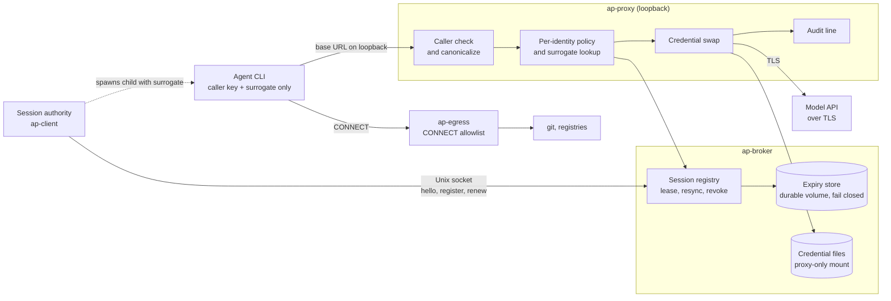
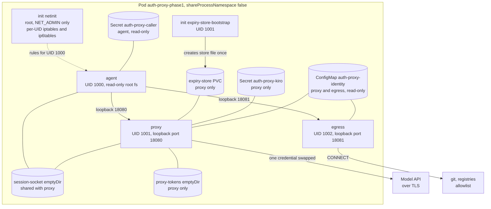

# auth-proxy

## How it works

An agent never holds a real credential. It sends requests to a loopback proxy with a caller key
and a surrogate. The proxy checks both, applies one real credential, and forwards the request
over TLS. A session authority registers each session's surrogate over a Unix socket. Non-model
traffic such as git goes through a separate allowlisting CONNECT proxy.

## Features

Implemented and tested in Phase 1:

- Caller-key routing and surrogate credential swap ([design](docs/design/phase1.md))
- Per-identity TOML policy with fail-closed checks ([design](docs/design/phase1.md))
- Canonicalization, and refusal of ambiguous hosts and paths
- 12 h absolute session TTL, lease renewal, and synchronous revoke ([session plane](docs/session-plane.md))
- Absolute expiry persisted across proxy restarts; the proxy fails closed without the store ([session plane](docs/session-plane.md))
- Resync with an explicit `expired` list ([session plane](docs/session-plane.md))
- ap-egress CONNECT allowlist; ap-egress resolves DNS itself and refuses private and IP-literal targets
- File-backed credential store that re-reads a file when it changes
- Kubernetes pod with per-UID iptables (Option A) and separate volumes ([pod.yaml](deploy/k8s/pod.yaml))
- 39-row fail-closed matrix, run by the manual-dispatch CI workflow ([matrix](tests/matrix/matrix.py))

## Todos

- ECS / Fargate deployment (Option C): deferred to a later phase
- Secrets Manager store (S2): deferred with ECS
- Phase 2 TLS interception (CONNECT with CA): no current CLI needs it
- Runtime-proof for `hello`: only the target is documented; same-UID processes can still read the proof
- Connection cap for ap-egress: every connection spawns a task
- Pruning of expiry records: pruning would let a re-registered key reset its 12 h cap
- 12 h absolute TTL has no config key: it is a fixed default
- Matrix positive rows run against a feature-enabled test binary, not the release binary
- Live run of the K8s pod on a cluster is not in CI: the validator checks the manifest only

## Kubernetes deployment (Option A)

One pod runs three app containers (agent, proxy, egress) and two init containers (netinit and
expiry-store-bootstrap). The agent can reach only the proxy and egress loopback ports, and it
cannot read the proxy's credential Secret. The netinit rules and the proxy/agent split were checked
on a single-node k3s test cluster. The egress container and the expiry store in `pod.yaml` were
not part of that run. ECS is not done yet.

- **Loopback rules:** netinit lets UID 1000 reach only ports 18080 and 18081 on loopback. Any other
  packet from that UID that leaves loopback is rejected. Replies on established connections stay
  allowed. The rules repeat for IPv6. Without them, the agent could reach the sidecar's internal
  ports and read the real credential, which the k3s run measured.
- **shareProcessNamespace is false:** the agent container cannot list or read the proxy's processes
  through `/proc`.
- **DNS is blocked for UID 1000:** the same reject rule drops the agent's DNS queries. Names resolve
  in the egress container.
- **NetworkPolicy alone is not enough:** containers in one pod share a network namespace, so a
  NetworkPolicy sees one pod address and cannot tell agent traffic from proxy traffic. The per-UID
  iptables owner match is what separates them.
- **Names come from `deploy/k8s/pod.yaml`:** container, volume and port names match that file.
  Image references are placeholders until a release pins digests.
