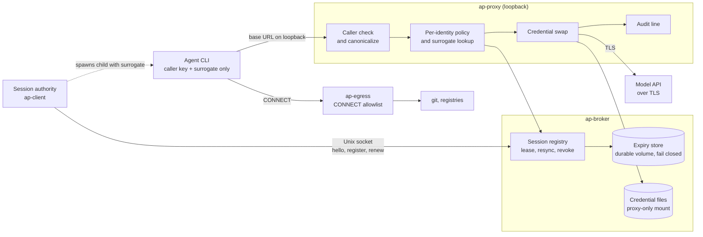

# auth-proxy

## How it works

An agent never holds a real credential. It sends requests to a loopback proxy with a caller key
and a surrogate. The proxy checks both, applies one real credential, and forwards the request
over TLS. A session authority registers each session's surrogate over a Unix socket. Non-model
traffic such as git goes through a separate allowlisting CONNECT proxy.

Implemented:

- Caller key and surrogate checks, canonicalization, per-identity policy, credential swap, and
  audit lines that never contain a key, surrogate, or credential.
- Session plane over a Unix socket: `hello` lock on Kubernetes, register, renew, resync, and
  revoke. Each session has an absolute TTL of 12 h, stored durably. The proxy fails closed when
  the expiry store is not writable.
- Credentials read from files in a proxy-only mount, re-read when the file changes.
- ap-egress: CONNECT allowlist, DNS resolved by ap-egress itself, and refusal of private
  addresses and IP-literal targets.

Not implemented:

- ECS/Fargate deployment
- Secrets Manager credential store
- Phase 2 TLS interception
- Runtime-proof `hello` (today `hello` takes only an identity name)
- Connection cap in ap-egress
- Pruning of expiry records (records are never removed)
