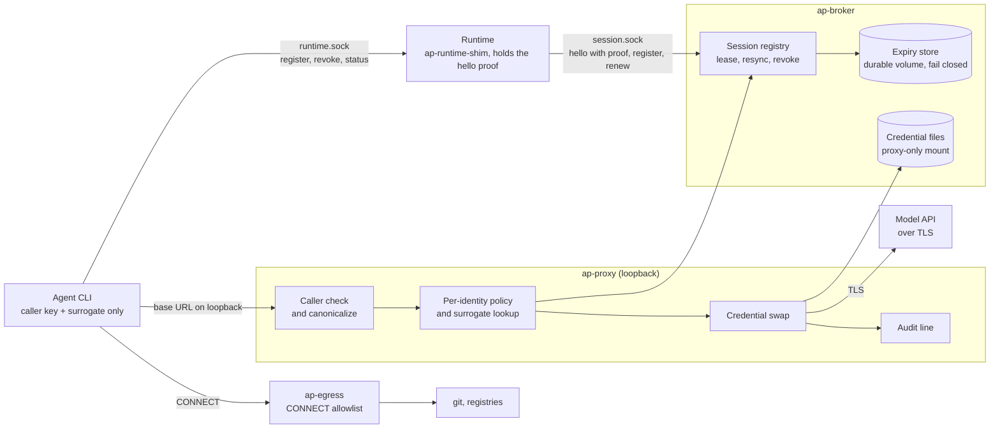
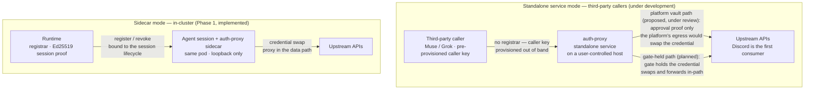
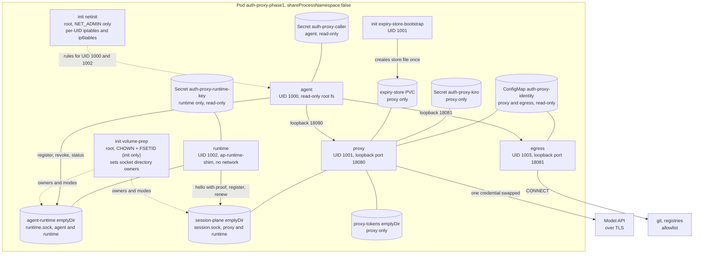

# auth-proxy

## How it works

An agent never holds a real credential. It sends requests to a loopback proxy with a caller key
and a surrogate. The proxy checks both, applies one real credential, and forwards the request
over TLS. A runtime registers each session's surrogate with the proxy over a Unix socket, and it
proves its identity to the proxy with a signature only it can make. Non-model traffic such as git
goes through a separate allowlisting CONNECT proxy.

## Deployment models

auth-proxy runs in two deployment models. The gate's mechanisms — caller check,
canonicalization, per-identity policy, credential swap, and audit — work the same in
both, and the planned `require_approval` mechanism ([#5](https://github.com/openabdev/auth-proxy/issues/5);
not implemented in Phase 1) is meant to behave the same in both. What changes is the trust
scaffolding around the gate: who vouches for the caller, where the proxy sits, and
where the real credential lives.

**Sidecar mode** is the original, in-cluster shape, and the one Phase 1 implements.
The proxy runs as a same-pod sidecar next to agents spawned by our own runtime
(openab-pty / OpenAB classic). The runtime registers each session's surrogate with
an Ed25519 proof, and revocation is bound to the session lifecycle: the session
ends and the surrogate is revoked. Once `require_approval` ([#5](https://github.com/openabdev/auth-proxy/issues/5))
lands, the session end is also meant to drop that session's parked requests. The agent
reaches the proxy over loopback only, the proxy is in the data path, and upstream
credentials live in the proxy's own store. See
[Kubernetes deployment (Option A)](#kubernetes-deployment-option-a) below.

**Standalone service mode** serves callers on platforms we do not operate — Muse,
Grok, or another external agent platform. There is no runtime and no registrar, so
caller keys are provisioned out of band, and the proxy runs as a standalone,
reachable service on a host the user controls. Enforcement shifts from network
control to credential control, in two sub-shapes.

- **Gate-held path.** The gate holds the credential in its own store and forwards
  in-path. Once `require_approval` lands, this path would forward after approval.
  This is the shape described in [#5](https://github.com/openabdev/auth-proxy/issues/5).
- **Platform vault path (proposed, under review).** If the caller's platform has its
  own vault and egress enforcement (Muse), the gate would hold no credential and stay
  out of the data path: it would issue a one-time approval proof bound to the request
  hash, and the platform's egress would swap in the credential. This is a new
  architecture that #5 does not contain and no design review has covered yet. It is
  not settled and is not part of Phase 1.

This mode is **under development** and is not part of Phase 1; its first consumer is
tracked in [#5](https://github.com/openabdev/auth-proxy/issues/5).

## Muse gated passthrough (stage 1, pilot)

A second mode for one consumer (Muse) and one upstream (Discord): the caller's own `Authorization`
passes through unchanged and the gate only decides allow or deny. The caller key travels in a header,
the route is a path prefix mapped by policy to a fixed host, reads on granted prefixes pass, and
everything else (writes included) is refused with 423 `no_grant` and an `X-AP-Decision` header. It
needs no session machinery and does not change the sidecar mode.

The gate constrains the agent, not the Muse platform: Muse's egress holds the real Discord token and
can call Discord directly. See `docs/design/muse-gated-passthrough.md`, `docs/runbooks/muse-stage1.md`
and `deploy/muse/pilot-policy.example.toml`.

## Muse gated passthrough (stage 2, pilot)

Stage 2 adds a third verdict, `hold`, for writes the owner wants to approve one by one. A held request
keeps its connection open. The gate tells the owner a request is waiting (a fixed text and a link, never
the content), the owner opens a separate approval page, and only an explicit approve forwards the request.
Deny, expiry (`hold_secs`), a caller who gives up, a policy reload that drops the identity, and shutdown
all end the request with a refusal and nothing sent upstream. The connection is the state: there is no
queue, and a restart forgets every held request.

The gate constrains the agent, not the Muse platform. Muse's egress holds the real Discord token and can
call Discord directly. A stolen caller key lets someone send requests as that identity (the per-identity
cap and the cooldown bound the prompt spam) and does not give them approval rights.

Not claimed: exactly-once delivery (if the request was forwarded and the response was lost, a retry can be
approved and forwarded again), protection against Muse itself, a measured end-to-end hold window through the
real front, or a measured disconnect signal through the front. See `docs/runbooks/muse-stage2.md`
and `docs/design/muse-gated-passthrough.md`.

## Features

Implemented and tested in Phase 1:

- Caller-key routing and surrogate credential swap ([design](docs/design/phase1.md))
- Runtime proof for `hello`: Ed25519, the seed held by the runtime container only. A process inside that container can still sign ([session plane](docs/session-plane.md))
- Agent-runtime socket: the agent registers, revokes and reads status through the runtime, and nothing else ([session plane](docs/session-plane.md)). The status read is unit-tested, not pod-tested
- Per-identity TOML policy with fail-closed checks ([design](docs/design/phase1.md))
- Canonicalization, and refusal of ambiguous hosts and paths
- 12 h absolute session TTL, lease renewal, and synchronous revoke ([session plane](docs/session-plane.md))
- Absolute expiry persisted across proxy restarts; the proxy fails closed without the store ([session plane](docs/session-plane.md))
- Resync with an explicit `expired` list ([session plane](docs/session-plane.md))
- ap-egress CONNECT allowlist; ap-egress resolves DNS itself and refuses private and IP-literal targets
- File-backed credential store that re-reads a file when it changes
- Kubernetes pod with per-UID iptables (Option A) and separate volumes ([pod.yaml](deploy/k8s/pod.yaml))
- 41-row fail-closed matrix, run by the manual-dispatch CI workflow ([matrix](tests/matrix/matrix.py))
- [Phase 1 status](docs/status/phase1.md)

## Todos

- ECS / Fargate deployment (Option C): deferred to a later phase
- Secrets Manager store (S2): deferred with ECS
- Phase 2 TLS interception (CONNECT with CA): no current CLI needs it
- Connection cap for ap-egress: every connection spawns a task
- Pruning of expiry records: pruning would let a re-registered key reset its 12 h cap
- 12 h absolute TTL has no config key: it is a fixed default
- Matrix positive rows run against a feature-enabled test binary, not the release binary
- Live run of the K8s pod on a cluster is not in CI: the validator checks the manifest only
- The signature check on the runtime proof is not a constant-time comparison. The design note explains why; revisit if the proof path changes.
- The manifest validator does not catch the runtime proof seed being exposed through env or secretKeyRef. Add a check.
- The 503 error code on the hello path is `unavailable` in the code and `broker_unavailable` elsewhere in the design. Align them.
- The final checks summary lists one test target with 0 passed; the workspace total (289) appears only in the report.

## Kubernetes deployment (Option A)

One pod runs four app containers (agent, runtime, proxy, egress) and three init containers
(volume-prep, netinit, expiry-store-bootstrap). The agent reaches the proxy and egress over
loopback, and the runtime over its own Unix socket. It has no path to the session socket, and it
cannot read the proxy's credential Secret or the runtime's proof seed.

Measured: the runtime split ran on an OrbStack cluster (arm64) and on a second k3s node (amd64).
Both runs used `pod.yaml` with a mock upstream and dummy credentials, with these caveats: the proxy was a test-only build with the `matrix-upstream` feature, which prints a TEST BUILD banner; the images were test-tagged; and checks A(i-b) and A(iii) used a test-only overlay pod with a shell wrapper. Not run: the real upstream, real credentials, the 12 h lapse on a cluster, and ECS. These checks passed on both:
all init containers exited 0 and all app containers became ready; the netinit rules for UID 1002
were in place; the agent reached the proxy and egress on loopback; direct TCP and DNS from the
agent were blocked; register and revoke worked through `runtime.sock`; the upstream saw the
real credential and never the surrogate or the caller key; no secret appeared in container logs;
the expiry store survived a pod delete and recreate; and the agent could not read the runtime key
or open `session.sock`. The proxy accepted the runtime's signed `hello`, and `runtime.sock`
refused `hello` for the agent. With the runtime killed, `session.sock` stayed unreachable to the
agent in all 60 samples over about 4 minutes.

Not measured: a real upstream with real credentials; the 12 h TTL lapse on a cluster (unit tests
only); NetworkPolicy, which Phase 1 does not use; and ECS, which is not started.

The evidence record for the runtime split is [docs/evidence/runtime-split.md](docs/evidence/runtime-split.md).

- **Loopback rules:** netinit lets UID 1000 reach only ports 18080 and 18081 on loopback. Any other
  packet from that UID that leaves loopback is rejected. Replies on established connections stay
  allowed. The rules repeat for IPv6. Without them, the agent could reach the sidecar's internal
  ports and read the real credential, which the k3s run measured. UID 1002 (the runtime) gets
  replies on established connections and nothing else, since its sockets are all Unix sockets.
- **Runtime split:** the agent holds no hello proof and no route to `session.sock`. Its one
  session-plane path is `runtime.sock`, which serves register, revoke and status. The socket
  directories are owned by the proxy and runtime UIDs and setgid, so the agent is in neither group
  that can connect to `session.sock` (mode 0660).
- **shareProcessNamespace is false:** the agent container cannot list or read the proxy's processes
  through `/proc`.
- **DNS is blocked for UID 1000:** the same reject rule drops the agent's DNS queries. Names resolve
  in the egress container.
- **NetworkPolicy alone is not enough:** containers in one pod share a network namespace, so a
  NetworkPolicy sees one pod address and cannot tell agent traffic from proxy traffic. The per-UID
  iptables owner match is what separates them.
- **Names come from `deploy/k8s/pod.yaml`:** container, volume and port names match that file.
  Image references are placeholders until a release pins digests.
