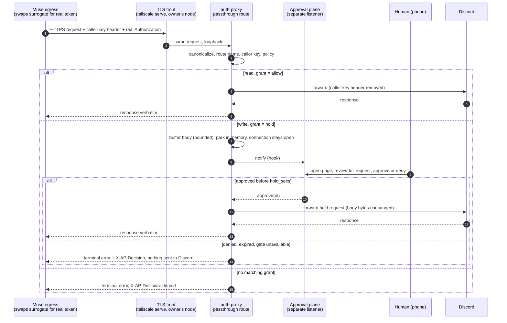

# Muse gated passthrough: a hold-the-connection approval gate

Status: design only, no code. Branch `design/muse-gated-passthrough`, based on `main` at the merge of
PR #11 (`b3f7864`). Scope: a minimal proof of concept (PoC) for one consumer, Muse calling the Discord
HTTP API through auth-proxy in standalone service mode.

This document supersedes, for this PoC only, two earlier sketches: the "platform vault path" in the
README Deployment models section, and the parked-and-polled design in
[#5](https://github.com/openabdev/auth-proxy/issues/5). It does not change Phase 1.

## How claims are labelled

- **[M]** measured: run or seen in output during this design work. The tag names what was run.
- **[I]** inferred from code or docs. The tag names the file or issue, e.g. `[I forward.rs]`.
- **[A]** assumed. Includes facts stated by the owner about Muse (written `[A owner]`), and anything about
  Muse or Discord that this repository cannot show. An `[A]` claim is a risk until someone checks it.

Statements of the form "the PoC does X" are design proposals and carry no tag.

## 1. Requirements

Stated by the owner and treated as fixed [A owner]:

1. A user creates a Muse custom connector for the gated Discord API. The connector points at our base URL
   and carries a header with a key (the caller key). Muse's custom connector always routes to us.
2. Muse replaces its own surrogate with the real Discord credential **before** the request reaches us.
   The request arrives with the real `Authorization` header. We never swap and never store a credential.
   We only decide pass or no-pass.
3. The request is the full Discord HTTP request. Policy per identity: reads (`GET` on allowed prefixes)
   pass immediately. Writes (for example `POST /channels/{id}/messages`) are held.
4. For a held request the proxy holds the connection until the human approves on the phone. It then
   forwards the held request to Discord and returns Discord's response verbatim (status,
   headers minus hop-by-hop, body; any `x-ap-*` headers Discord sends are preserved). "Unchanged" means the body bytes plus the semantic header set
   (section 3.1), not the wire framing, header case or header order. Muse needs no approval proof or token.
5. Every refusal the gate generates carries `X-AP-Decision: denied|expired|unavailable|rejected`, and that
   header is authoritative. Deny and expiry also use statuses Discord does not return (423 and 410). The
   other refusals (400, 401, 405, 413, 501, 503) reuse statuses Discord can return, so the header, not the
   status, tells a client that the gate answered. A gate refusal sends nothing to Discord; the one
   exception is a failure after the first upstream request byte, which has no synthetic response
   (section 3.5). Discord's own responses, including any `x-ap-*` headers they carry, pass through
   unchanged.
6. The connection is the state. There is no durable approved state, no polling endpoint and no one-time
   proof. A crash after approval and before forwarding loses the held connection, nothing executes, and
   Muse's retry starts a new approval round.

## 2. Overview



The caller path (Muse to the public listener) and the approval path (human to the approval listener) never
share a listener, a credential, or a router (section 3.6).

## 3. Design

### 3.1 Request handling in a passthrough route

A passthrough route is a route whose host is fixed in configuration, whose request carries the real
credential from the caller, and which has no credential store entry. The pipeline for a passthrough route
reuses Phase 1 steps 1 to 3 and 6 and skips steps 4, 5 and 7 [I phase1.md section 4; pipeline.rs]:

1. Refuse `CONNECT` (405) and `Upgrade` (501), as in Phase 1 [I pipeline.rs `handle`], each carrying `X-AP-Decision: denied`.
2. Canonicalize: origin form, one `Host`, no ambiguous path (section 3.8).
3. Read the caller key from the header (section 3.2), find the identity by constant-time hash compare.
4. Evaluate policy for identity, route, method and route-relative path. Result is `allow`, `hold` or deny.
5. `allow`: forward now. `hold`: section 3.4. Deny: terminal error (section 3.5).
6. Audit: one record per allowed request, hold transitions for a held one (section 3.9).

The upstream host comes only from the route configuration, never from the request. The route is chosen
by a name in the URL path that policy maps to a fixed host. An unknown route name fails closed (423 `denied`, code
`route_unknown`, nothing sent), and no part of the request, including `Host`, a query parameter or a header, can supply an
upstream host (this closes server-side request forgery). The forwarder keeps
its Phase 1 properties: rustls with SNI equal to the route host, no redirect following, so a 3xx from
Discord goes back to Muse unchanged [I forward.rs `client_builder`].

Route addressing. Muse is given a base URL. The PoC uses path-prefix routing, for example
`https://<public-host>/discord/api/v10/channels/...`, and not a `?upstream=` query. The Discord path after
`/<route>` is forwarded unchanged. Whether a Muse connector accepts a base URL with a path prefix is
unknown [A]; see open question 4.

Headers forwarded upstream (passthrough). One ordered algorithm:

1. Refuse framing conflicts (framing policy below) before policy evaluation.
2. Strip: the caller-key header; every other `x-ap-*` header; hop-by-hop headers and every header named by
   `Connection`; `Host` (set to the route host, which necessarily differs from what Muse sent); and the
   front-added list, a configurable set that defaults to `Forwarded`, `X-Forwarded-*`, `X-Real-IP`, `Via`,
   `CF-*` and `Tailscale-*`.
3. Of `AUTH_HEADERS` [I headers.rs], only `Authorization` is forwarded by default. `Cookie`,
   `Proxy-Authorization`, `X-Api-Key`, `X-Goog-Api-Key`, `Api-Key`, `X-Amz-Security-Token` and every other
   member are stripped unless the route's keep list names them. The default keep list is empty [A, Muse is
   expected to send none of them]. This is the difference from Phase 1, where `strip_request_headers`
   removes all of `AUTH_HEADERS` before the swap [I headers.rs].
4. Forward every remaining end-to-end header.
5. Set `Host` and framing.

Tailnet identity headers that `tailscale serve` injects are ignored: no decision reads them, and
`Tailscale-*` is stripped in step 2. The caller key is the only caller authenticator.

- `Expect: 100-continue` is never forwarded. On the direct path the proxy answers it, sending `100 Continue`
  only after the verdict allows reading the body, so a denied request never receives one. Behind
  `tailscale serve`, the front decides when Muse receives `100 Continue` and reads Muse's body itself, so
  that claim holds only on the direct path [A for the front].
- Semantic header set: the set of header names and values, with repeated headers kept as repeated values
  in order. Case and wire order may differ. "Unchanged" in this document means the body bytes and this
  set, with the exclusions above.
- Framing policy, applied before policy evaluation: a request with both `Content-Length` and
  `Transfer-Encoding`, with more than one or a comma-joined `Content-Length`, or with a `Transfer-Encoding`
  other than a single `chunked` is refused 400 (`framing_refused`) and produces no upstream request. hyper's
  HTTP/1 parser may refuse some of these before the handler runs, in which case the answer is hyper's, not
  ours. The gate does not rely on that. Stage 1 sends raw HTTP/1 requests
  directly and through the front and records which layer refused and whether the answer carries
  `X-AP-Decision`.
  **Known gap (stage 1, decided by the owner):** hyper 1.12 changes three cases before the handler can see
  them [I hyper-1.12.0 `proto/h1/role.rs`]: it deletes `Content-Length` when `Transfer-Encoding: chunked`
  is present, it collapses identical duplicate `Content-Length` headers into one, and its parser accepts a
  bare LF line ending. The handler therefore cannot refuse these three, and a direct request carrying one is
  forwarded. Stage 1 accepts this because the listener is loopback-only, so a direct request is possible
  only from the proxy host itself, and the real path goes through the owner's `tailscale serve`, which was
  measured to normalise or terminate all three [M, source: `docs/evidence/muse-stage1-front-measurements.md`].
  The fix is a connection-level raw-head scanner (about 100 lines, with a Content-Length and chunked
  body-length tracker so it finds each head on a keep-alive connection). It is the stage 2 candidate and must be decided
  before any listener is exposed beyond the front. It was not built now because a second HTTP parser in
  front of hyper adds a parser-differential surface, and `keep_alive(false)` would change behaviour that
  the front's pooled connections rely on.
- Body framing: a held body gets a `Content-Length` computed from the buffered bytes. An allowed request
  forwards a declared `Content-Length` as declared, and an allowed chunked body is forwarded chunked, with
  no buffering and no computed length. The body bytes are unchanged; only framing, which is hop-by-hop,
  differs.
- Allowed-request boundary: the first request byte handed to the upstream connection. Failures before it
  are 503 `unavailable` (413 `body_too_large` for an undeclared body over the cap); failures after it close
  the client connection without a synthetic decision, and the one audit record carries `code =
  upstream_reset` or `body_failed_after_send` (section 3.5).
- More than one `Authorization` header is refused on every passthrough route, allowed or held (400,
  `X-AP-Decision: denied`, code `authorization_duplicate`), because a gate cannot say which one Discord will read. [A] that Discord
  reads only one.

A request to a held route with no `Authorization` header is refused before it reaches the human
(400, `X-AP-Decision: denied`, code `credential_missing`). The human is not asked to approve a request Discord will reject with 401, and
the audit record shows that Muse's swap did not happen. Open question 9 asks the owner to confirm.

### 3.2 Caller key in a header (open point a)

Phase 1 puts the caller key in the path, `/ap/<caller-key>/...` [I canon.rs `parse_ap_path`]. The Muse
case needs it in a header, because the connector holds a header value and the path belongs to Discord.
`Authorization` cannot carry it, since that header holds the real Discord credential [A owner].

Proposal: a dedicated header, default name `X-AP-Caller-Key` (configurable, since the Muse connector's
constraints on header names are unknown, open question 2). Value format is unchanged: `apk_` plus 64
lowercase hex, checked by the existing `is_caller_key` [I canon.rs].

What is better than the path:

- A path key appears in every access log, proxy log and URL display on the way. A header key does not
  appear in a URL.
- Phase 1 audit has no field that can carry a caller key or query [I audit.rs doc comment]; the same
  holds for a header if the controls below are applied.

What is worse, and the control for each:

| Risk | Control |
|---|---|
| Header values appear in debug dumps, panics, and the TLS front's logs | Mark the value sensitive on ingest (`HeaderValue::set_sensitive`, which the `http` crate prints as `Sensitive` [I http crate docs]). Never log request headers. Implement `Debug` by hand on any struct that holds headers. Configure the TLS front not to log headers [A]. |
| The key could be forwarded to Discord | Remove it in the passthrough header builder, by name, and also remove every `x-ap-*` header. Acceptance test: a mock upstream echoes received headers and must not see the key (section 7). |
| Timing side channel on compare | Reuse `caller_identity`: hash the presented key with sha256, then compare against every identity with `ConstantTimeEq`, so time does not show which identity matched [I pipeline.rs `caller_identity`]. |
| Duplicate or malformed header | Two values, or a value not matching `apk_<64 hex>`, is `caller_rejected`, never a guess at which value counts. |
| Key in the Muse connector configuration | Out of our control [A]. The key is a 256-bit random value, revocable by deleting the identity from the policy file (hot reload exists [I pipeline.rs `App::policy`]). |

The caller key authenticates the connector to the gate. It is not a Discord credential and not an
approval credential.

### 3.3 Policy: a third verdict, and segment patterns

Phase 1 policy answers allow or deny. A grant is `{identity, credential, route, methods, paths}` with
prefix matching on `paths` [I policy.rs `evaluate`; config.rs `Grant`]. Two changes are needed:

1. **Verdict.** A grant gains `decision = "allow" | "hold"`. A passthrough grant has no `credential`
   (today `credential` is a required field [I config.rs `Grant`]). If more than one grant matches, `hold`
   beats `allow` (the stricter wins). No match is deny, as today.
2. **Exact segment patterns for writes.** Prefix matching cannot say "`POST /channels/{id}/messages` and
   nothing under it". A prefix `/api/v10/channels/` would also match `POST /api/v10/channels/1/messages/2/reactions`
   and every other POST below it. Add `path_patterns`, where each segment is a literal or `*` (exactly
   one non-empty segment, no `/`), matched against the whole path with no prefix semantics. Reads may keep
   prefix `paths`. [A] This is the only policy-language extension the PoC needs.

Example, for the identity of one Muse connector (names are illustrative):

```toml
[[route]]
name = "discord"
host = "discord.com"
mode = "passthrough"

[[grant]]
identity = "muse-alice"
route = "discord"
methods = ["GET"]
paths = ["/api/v10/channels/", "/api/v10/guilds/", "/api/v10/users/@me"]
decision = "allow"

[[grant]]
identity = "muse-alice"
route = "discord"
methods = ["POST"]
path_patterns = ["/api/v10/channels/*/messages"]
decision = "hold"
```

Everything else, including `PUT`, `PATCH`, `DELETE` and `POST` to other paths, is denied.

### 3.4 The hold

Sequence for a `hold` verdict:

1. Decide on method and path before reading the body. A denied request is answered without holding the
   body. Before the response the proxy drains up to `held_body_max_bytes` of the inbound body within
   `body_read_secs`, or else sends the response and half-closes with a short linger, so that a client
   still writing a large body can read the 423 instead of seeing a reset [A, client behaviour on early
   response is not verified; stage 2 tests it]. The drain is skipped when the request carried
   `Expect: 100-continue` and no `100 Continue` was sent, since no body will arrive and the drain would wait
   `body_read_secs` for nothing.
2. Require `Content-Type: application/json` (parameters allowed) before reading the body. `multipart/*`,
   any other media type or none is 400 `denied`, code `content_type`, regardless of size, so attachments
   are refused here. [A] Muse sends JSON for message create. Then read the body into memory, bounded by
   `held_body_max_bytes` and `body_read_secs`; the cap independently bounds held bodies. Over the cap is
   413 with `X-AP-Decision: denied`; the request is not held.
3. Require `Content-Encoding` absent or `identity`. A compressed body cannot be shown to the approver as
   the bytes Discord will decode. [A] Muse does not compress requests; if it does, the answer is deny,
   not decompress (400 `denied`, code `content_encoding`).
4. Compute two values over the complete outbound semantic request: method, route name, raw path, raw
   query, the forwarded header set (names and values, repeated headers in order, after the strip algorithm
   of section 3.1) and the body bytes, as length-prefixed fields. The *audit digest* is sha256 of that
   encoding with credential header values (`Authorization` and any kept `AUTH_HEADERS`) replaced by a fixed
   marker. It is shown to the approver and written to the audit record, and it reveals nothing about a
   credential. The *equality fingerprint* is an HMAC-SHA256 under a random per-process key over the same
   encoding with the credential values included. It lives only in the entry, in memory, is never logged,
   shown or sent, and exists only to decide whether two requests are the same for dedupe. Dedupe assumes Muse sends identical
   headers on a retry [A]; if a per-request header (trace or request id) differs, stage 2 needs a
   route-level fingerprint-exclusion list (excluded from the fingerprint, not from forwarding). Neither value is
   an input to approve: the approval API takes the entry id only. The entry is immutable in memory, so the
   id already names exactly the bytes that will be sent.
5. Admission order for a new hold: (a) cooldown for the identity (503 `cooldown`); (b) dedupe: if a
   `Pending` entry of the same identity has the same equality fingerprint, the new connection supersedes
   it. The older connection is answered 503 `superseded`, nothing is sent for it, and the new entry gets
   its own id and the old entry's notification is updated to point at it, so the human sees one prompt. A page
   for the old id shows a visibly distinct `superseded` state (banner, approve and deny disabled, link to the
   newest entry), not `gone`. A superseding retry does not count against the caps; (c) caps:
   `max_held_per_identity`, then `max_held_total` (503). A cooldown affects only new holds; `Pending`
   entries already held for that identity stay held. A request that differs in any forwarded header or
   credential value is a different request and gets its own entry and its own notification. Notification
   count: one per distinct pending entry, so at most `max_held_total` at any moment. An agent that changes
   the request on each retry is bounded by the per-identity cap and by the cooldown after a deny or
   expiry, and by nothing else (a per-minute rate cap is out of scope). Then write the `held` audit
   record; if the write fails, refuse 503 `audit_unavailable` before the entry is inserted or any
   notification fires. Then insert the entry in the in-memory table (section 3.7), fire the notification
   (new entries only, not supersedes), and wait for the decision up to `hold_secs`. `audit_unavailable`
   starts no cooldown: a sink failure is not the identity's doing, and the per-identity cap bounds the
   prompts it can cause (none before the hold; one per attempt after approve).
6. The entry is a state machine guarded by one mutex: `Pending` to exactly one of `Approved`, `Denied`,
   `Expired`, `Abandoned` (caller disconnected), `Superseded` or `Dropped` (identity removed on reload,
   section 3.9). The first transition wins. A held request cannot be approved twice, because `Approved`
   is not re-enterable. This design is single-instance only: the table is per process, and a second
   instance behind the front would not see the first one's entries.
7. Disconnect detection. Under `axum::serve` a handler never sees the socket. The only signal is hyper's
   HTTP/1 connection task dropping the handler future when it reads EOF or an error on the connection
   while a response is pending [A, hyper behaviour not checked in this work]. The handler's Drop guard
   moves the entry to `Abandoned` when that happens. No other signal exists, and a custom accept loop is not
   part of the PoC. Behind `tailscale serve` the proxy sees only the front's loopback connection, so
   detection also needs the front to close that backend connection when Muse leaves [A]. Fallback if the
   signal does not fire: the entry stays `Pending` until `hold_secs`, an approve may forward a request
   whose caller is gone, and dedupe covers only an identical retry. The approval page therefore shows
   connection state as "unknown", not "open". Stage 1 records the signal on the direct path and through
   the front; if the direct path fails, stage 2 needs a custom serve loop.
8. Disconnect and approve are two distinct cases. (a) `Abandoned` before any approve: a later approve
   returns `gone`, and the audit shows `abandoned` only. (b) `Approved` won first, then the handler future
   is dropped or the caller-connected re-check fails before the send: the approve call returns
   `approved_but_abandoned`, nothing is sent, and the audit shows `abandoned_after_approve`. The approve
   call awaits a oneshot from the handler, bounded by a 2 s timeout (then `approved_unconfirmed`). The
   handler passes two milestones in order: (1) the upstream connection is established and the pre-send
   `forward_started` audit record is written (a connect failure is a terminal `connect_failed` transition
   with no `forward_started`; an audit failure is 503 `audit_unavailable`, nothing sent); (2) the first
   request byte is handed to the upstream connection. Only then does the oneshot resolve as success. If
   the handler is dropped between the two, the result is `approved_but_abandoned`. The forward runs in the
   handler's task, not in a detached task. If the drop happens after milestone 2, the request may already
   be at Discord; the audit shows `forward_started` without `completed`.
9. Discord's response streams back unchanged, as for an allowed request [I pipeline.rs step 9].

Approve results by state when the call arrives (the state machine of step 6 plus step 8):

| State | Approve result |
|---|---|
| `Pending`, forward reached milestone 2 | success |
| `Superseded` | `superseded`, with the newest entry id |
| `Approved` or `Denied` already | `already_decided` |
| `Expired` | `expired` |
| `Dropped` | `dropped` |
| `Abandoned` | `gone` |
| `Approved`, handler gone before milestone 2 | `approved_but_abandoned` |
| `Approved`, no oneshot within 2 s | `approved_unconfirmed` |
| `Approved`, audit write failed | `audit_unavailable` |
| `Approved`, upstream connect failed | `connect_failed` |

Cooldown. After a human deny or an `expired` verdict, new holds from that identity are refused with 503
`unavailable` (code `cooldown`) for `cooldown_secs`. The default is 60, and 0 disables it. The slot is
freed immediately on deny. This bounds the phone prompts from an agent that retries after a refusal.

What the approver sees is the data that will be sent, not a re-rendered form. The page shows the method,
route, raw path (with token segments redacted, section 3.9), raw query, content type, body size, the body
as escaped text (never as HTML), the digest, and the names of the headers that will be forwarded with their
values for non-credential headers. Credential header values (`Authorization` and the rest of
`AUTH_HEADERS`) are shown as present, not as values. The approver therefore sees every header that will
reach Discord, by name at least.

### 3.5 Outcome contract

Every refusal the gate generates carries `X-AP-Decision` and a small JSON body
`{"ap_decision": "...", "code": "..."}`. This table is the single list of gate refusals. Discord's response
is returned verbatim, including any `x-ap-*` headers it carries; the gate's own refusals are identified by
a locally generated status plus `X-AP-Decision`, and Discord is not expected to send that header [A].

| Case | Status (proposed) | `X-AP-Decision` | `code` | Sent to Discord |
|---|---|---|---|---|
| Human denied | 423 | `denied` | `human_denied` | nothing |
| No grant matches | 423 | `denied` | `no_grant` | nothing |
| Unknown route name | 423 | `denied` | `route_unknown` | nothing |
| Caller key missing, duplicate, malformed or unknown | 401 | `rejected` | `caller_rejected` | nothing |
| Canonicalization refusal (Phase 1 codes, for example `path_ambiguous`, `Host` mismatch) | 400 | `denied` | Phase 1 code | nothing |
| Framing conflict (section 3.1) | 400 | `denied` | `framing_refused` | nothing |
| More than one `Authorization` header | 400 | `denied` | `authorization_duplicate` | nothing |
| No `Authorization` on a held route | 400 | `denied` | `credential_missing` | nothing |
| Held body with `Content-Encoding` other than `identity` | 400 | `denied` | `content_encoding` | nothing |
| Held route without `Content-Type: application/json`, including `multipart/*`, any size | 400 | `denied` | `content_type` | nothing |
| `CONNECT` | 405 | `denied` | `method_not_allowed` | nothing |
| `Upgrade` | 501 | `denied` | `upgrade_not_supported` | nothing |
| Held body over cap, or allowed body over cap before the first upstream request byte (declared or not) | 413 | `denied` | `body_too_large` | nothing |
| `hold_secs` elapsed with no decision | 410 | `expired` | `expired` | nothing |
| Gate cannot decide, or fails before the first upstream request byte: policy unavailable, hold table full, per-identity cap, cooldown, superseded, shutting down, dropped on reload, body-read timeout, upstream connect failure | 503 | `unavailable` | `policy_unavailable`, `table_full`, `identity_cap`, `cooldown`, `superseded`, `shutdown`, `dropped_on_reload`, `body_read_timeout`, `connect_failed`, `audit_unavailable` (section 3.9) | nothing |
| Allowed or approved and forwarded | Discord's own | whatever Discord sends | n/a | the request |
| Failure after the first upstream request byte (reset, stalled or undeclared oversized allowed body, upstream error) | none: the client connection is closed | none | n/a | possibly the request |

If hyper refuses a request before the handler runs (section 3.1 framing policy), the answer is hyper's and
may lack the header; stage 1 records this. The three cases in the section 3.1 known gap never reach the handler.

Why these statuses: Discord's documented API statuses are 2xx, 304, 400, 401, 403, 404, 405, 429 and some
5xx [A, not checked in this work]. 423 and 410 are not expected from Discord. 400, 401, 405, 413 and 503
can occur on both sides, so for those the header is the only reliable marker. Whether Muse reacts badly to
unusual statuses is unknown (open question 5).

Two behaviours follow from "terminal":

- No `Retry-After` header and no hint that the same request may succeed later. An expired request is a
  recorded refusal, not a state to poll [I issue #5 comment, "expiry is a verdict, not a state"].
- A failure after the forward began, for example Discord resets the stream or the connection breaks after
  the request was written, closes the client connection without a synthetic decision or success, as Phase 1
  does [I phase1.md section 4, "Upstream error mid-stream"]. An allowed request keeps its single audit
  record with `code = upstream_reset`; a held one has `forward_started` and no `completed`. "Nothing sent" in the table applies only to the rows that say so: once a request byte has
  been written upstream the proxy cannot claim that Discord did not see it.
- `caller_rejected` has its own status (401) and its own code, so an auth failure is never read as a
  human denial.
- An allowed body that stalls past `body_read_secs` or exceeds the cap after a prefix was sent closes the
  client connection (audit `code = body_failed_after_send`). Before the first byte a stall is 503
  `unavailable` and an over-cap body 413.

### 3.6 Approval plane (open point e)

Requirement: it is authenticated independently of caller keys, and neither the agent nor Muse has a path
to it.

Structure, the same in every option below:

- A separate listener, separate router, separate credential. The public (caller) router does not mount any
  approval route, and the approval router does not accept a caller key. Nothing routes from one to the
  other except the in-process hold table.
- The approver credential is a different secret, stored only as a hash, unrelated to any caller key.
- Muse's egress can reach the public listener. It must not be able to reach the approval listener. That is
  a network property, not a code property; the acceptance test in section 7 checks it from the caller
  path.

The PoC approval plane is a minimal web page on a listener bound to loopback and published to the
owner's phone through a second `tailscale serve` mapping on its own port, never a path mount on the public
port; the ACL shape is in section 4.2 [A]. A local CLI over a Unix socket remains a fallback. The HTTP
API is client-agnostic (`GET /pending`, `GET /pending/<id>`, `POST /pending/<id>/approve|deny`), in line
with the #6 decision that app shells are thin clients over the same endpoints [I issue #6 comment 1].
WebAuthn approval over the digest is a later replacement for the credential step [I issue #6 comment 1].

Page controls:

- Authentication is an HTTP Basic realm. The approver credential is a secret unrelated to any caller key,
  compared in constant time against a stored hash.
- `approve` and `deny` are form `POST`s. A browser sends Basic credentials automatically, so each page
  carries a per-page CSRF token (random, bound to the entry id, single use) that the POST must echo.
- Every approval response, including errors, carries `Content-Security-Policy: default-src 'none';
  frame-ancestors 'none'; form-action 'self'`, `X-Frame-Options: DENY`, `Referrer-Policy: no-referrer`,
  `Cache-Control: no-store`, `Pragma: no-cache` and `X-Content-Type-Options: nosniff`. `default-src` does
  not cover `frame-ancestors`, so it is named, which stops a page framing the approve button over the
  owner's cached Basic credentials. The page has no script and no inline style, and renders the body and
  every value with HTML escaping.
- The page never renders or logs an `Authorization` value from a held request (the entry keeps it for
  forwarding but the view model omits it). It shows that the header is present.
- Notification carries a link and a one-line summary only (method, route, redacted path), never a body or
  a credential. A display is not a reliable push when the phone is locked [I issue #6 comment 2].

An unreachable approval plane is not a special case. Holds expire as `expired` after `hold_secs`. The
gate fails closed in time as well as in space [I issue #5 comment 1, point 3].

### 3.7 Concurrency and resource limits (open point f)

The public listener faces a network, which the Phase 1 agent listener does not. Today the proxy has no
connection cap and no header-read timeout on that listener: a search of `crates/ap-proxy/src` and
`crates/ap-core/src` for `timeout`, `Semaphore`, `ConcurrencyLimit` and `header_read` finds only the
upstream client's connect and idle timeouts [M grep over those two source trees]. The listener runs
HTTP/1.1 only (`axum` with the `http1` feature) [I crates/ap-proxy/Cargo.toml]. So a remote listener needs
these limits added. Proposed defaults, all configurable [A, values are starting points]:

| Limit | Default | Behaviour on exceed |
|---|---|---|
| `max_connections` on the public listener | 256 | accept then close, as `ap-egress` does [I config.rs `Egress.max_connections`] |
| `header_read_secs` | 10 | close |
| `body_read_secs` (held and allowed bodies) | 15 | held body: 503 `unavailable` (`body_read_timeout`), nothing held or sent. Allowed body: the same 503 before the first upstream request byte; after it, close with no synthetic decision (section 3.5) |
| `held_body_max_bytes` | 1 MiB | 413, `denied`, not held |
| `max_held_total` | 32 | 503, `unavailable`, not held |
| `max_held_per_identity` | 4 | 503, `unavailable`, not held |
| `cooldown_secs` (per identity, after deny or expiry) | 60 (0 disables) | 503, `unavailable`, not held (section 3.4) |
| `request_deadline_secs` (total, from first byte to last response byte, allowed and approved requests; an approved one counts from `forward_started`; a hold's wait is not counted) | 300 | close the connection |
| `upstream_idle_secs` (no byte from Discord on an allowed or approved stream) | 30 | close the connection |
| `hold_secs` | 120 (range 5 to 600) | `expired` |
| TCP keepalive on accepted sockets | not a PoC control [A] | Accepted sockets are the front's loopback connections, so keepalive on them cannot keep the Muse leg alive. Only the front's own keepalive affects that leg; stage 1 measures it |

Memory bound: `max_held_total` times `held_body_max_bytes` is 32 MiB, plus headers.

The hold timeout interacts with every idle timeout between Muse and the gate: the TLS front's read
timeout, any load balancer, and Muse's own client timeout. The effective window is the minimum of all of
them, and only `hold_secs` is ours [A]. Section 8 asks the owner to measure it, and stage 1 includes a
probe for exactly this (section 7).

Shutdown: on SIGTERM the proxy answers every `Pending` entry `unavailable`. An entry already past `forward_started` runs to completion or to `request_deadline_secs`, then the process exits. On crash the OS resets
the sockets (section 5).

Held entries live in process memory only. Nothing about a held request, including headers, is written to
disk or to the audit stream.

### 3.8 Canonicalization for policy matching (open point g)

Reuse Phase 1, and add the few rules a remote, header-keyed, write-capable route needs.

Reused unchanged [I canon.rs; pipeline.rs `handle`]:

- Origin form only; exactly one `Host`; no userinfo (`check_origin_form`).
- `path_ambiguous` on the raw, still-encoded path: refuses `.` and `..` segments, empty interior
  segments, `%2e`, `%2f`, `%5c`, `%00`, backslash and `%25` followed by `2e` or `2f`.
- Matching runs on the raw wire form. No layer decodes before policy sees the path ("No decoding layer may
  disagree with the policy check about what a path is" [I canon.rs module doc]).

Added for passthrough:

1. **Expected `Host`.** `check_origin_form` compares `Host` with the listener's own bind address
   [I pipeline.rs `listen_authority`]. A remote listener behind a TLS front is expected to see the public name [A, which `Host` `tailscale serve` passes to the backend is not shown here; stage 1 records it], so the
   passthrough listener takes a configured `public_authority`.
2. **No second decode.** The path forwarded upstream is the same raw string the policy matched, and the
   query is forwarded raw. Because the policy is an allow list with default deny, an encoding the policy
   does not recognize fails to match and is denied; it cannot turn a write into a read.
3. **Method** is the exact received token; only listed methods match; `HEAD` and `OPTIONS` need a grant.
4. **Path patterns** are matched whole-path, segment by segment (section 3.3). Query is not part of the
   match, and is shown to the approver.
5. **Body size cap** per section 3.7 before policy returns `hold`. An `allow` request keeps the Phase 1
   cap `limits.max_body_bytes`, default 32 MiB [I config.rs `Limits`].
6. **`Content-Encoding`** on a held request must be absent or `identity`.
7. **Duplicate security-relevant headers** (caller key, `Authorization`) are refused, not merged.

### 3.9 Audit

Phase 1 writes one line per request with no field for a key, credential or query [I audit.rs]. The
passthrough mode adds fields and transitions, and keeps that property:

- Transitions for a held request: `held`, then one of `approved`, `denied`, `expired`, `abandoned`,
  `superseded` or `dropped_on_reload`, then `forward_started`, `completed`, `abandoned_after_approve`
  (approved, but the caller was gone before the forward started, nothing sent), `connect_failed` (no
  `forward_started`) or `audit_unavailable`. An allowed request keeps Phase 1's single record, with
  `code = upstream_reset` or `body_failed_after_send` after a post-first-byte failure. Each carries the request
  id, identity, route, method, the redacted route-relative path (below), the digest, and for decisions the
  approver identity.
- `dropped_on_reload`: when a policy reload removes an identity, its `Pending` entries move to `Dropped`,
  are answered 503 `unavailable`, and nothing is sent. Entries of identities that remain are untouched.
- `auth_present` (boolean). It gives stage 1 evidence that Muse's swap happened without logging the token.
- Path redaction. Discord paths can carry secrets: the token segment of `/webhooks/{id}/{token}...` and
  `/interactions/{id}/{token}/...` is replaced by `<redacted>` in the audit record, on the approval page
  and in the notification. The audit may instead carry the matched grant pattern. No raw path is logged
  for these prefixes.
- No header value of any kind, no query, no body.
- The `forward_started` record is written after the upstream connection is established and before the
  first request byte, so the record precedes the action [I issue #5 comment 1, point 1]. Phase 1's audit sink is stdout and a failed write does not
  refuse a request [I phase1.md section 4, "Audit write failure"]; the PoC keeps that behaviour for allowed reads.
  **Stage 2 requirement (settled, owner decision):** on held (write) routes a
  failed `held` or `forward_started` audit write refuses the request (503 `unavailable`, code
  `audit_unavailable`, nothing sent upstream; a failed `held` write also creates no entry and no
  notification), so no write executes without a record. This reverses the earlier cut of the
  fallible-sink requirement for writes only.

## 4. Trust model changes (open points b and c)

### 4.1 The Phase 1 invariant that no longer holds

Phase 1: the real credential never leaves the proxy; the agent holds only a surrogate [I phase1.md;
issue #5, "Security invariants"]. In this mode **the real Discord token transits our service**, in the
clear after TLS termination, in every request. It is held in memory for up to `hold_secs` for held
requests. The gate is no longer a credential custodian. It is a decision point on a path that carries the
credential.

What still holds: the agent that talks to Muse does not hold the credential (Muse's egress swaps it in
[A owner]), and a write reaches Discord only after a human approves it.

### 4.2 Compensating controls (required for the PoC)

1. **Encrypted remote leg, self-run terminator.** Decided by the owner: TLS terminates in `tailscale
   serve` on the owner's own node, which forwards to the proxy on loopback. The proxy keeps
   `bind_loopback`, which refuses any non-loopback bind [I listener.rs]. There is no `bind_remote`, no
   native TLS in the proxy and no managed third-party tunnel. **Whoever terminates TLS sees the token**;
   here that is the owner's own node, inside the trust boundary. ACL shape, in words [A, the tailnet policy is the owner's to write]: Muse's tag may
   reach the owner's node on the public port only; the owner's own devices may reach the owner's node on
   the approval port; the Muse tag has no other grant, so default deny covers every other node and port,
   SSH included. The two `tailscale serve` mappings use two distinct ports and neither is a path mount on
   the other, because ACLs are per node and port. The proxy ignores the identity headers `tailscale serve`
   injects for every decision and strips them before forwarding (section 3.1). Whether `tailscale serve` interrupts a long-held idle connection is unmeasured [A];
   stage 1 measures it.
2. **Redact credentials everywhere.** `Authorization`, `Cookie`, `Proxy-Authorization`, the caller-key
   header and the rest of `AUTH_HEADERS` [I headers.rs] are never written to audit, error bodies, logs,
   panic messages or debug output. Concretely: sensitive-marked header values, hand-written `Debug` for
   held entries and request wrappers, error bodies built from fixed strings (as `Code::message` is
   [I error.rs]), no request-header logging in the TLS front, and panic handling that does not print
   request data.
3. **Held requests in memory only, bounded.** Count, size and lifetime as in section 3.7. Nothing is
   persisted. On shutdown the table is dropped.
4. **Fail closed.** Unknown, unavailable or full means refuse, with `X-AP-Decision: unavailable`, and
   nothing is sent to Discord. Policy unavailable is 503 as in Phase 1 [I pipeline.rs].
5. **Fixed upstream.** The upstream host is route configuration, TLS-verified, with no redirects followed
   [I forward.rs]. A caller cannot aim the token at another host.
6. **Reduce what a leaked token can do.** This is outside the gate and listed for completeness: use a bot
   token scoped to the channels the connector needs, and rotate it if the gate host is ever suspected.

### 4.3 What this gate does not protect against (open point c)

The caller key is not bound to the Discord token. Anyone who steals a caller key can send requests for
that identity, which allows phone-prompt spam, and can use the gate as a relay for a Discord token they
already hold, within the identity's policy. This is an accepted PoC limit. Revocation is deleting the
identity, and the cooldown and per-identity cap bound the prompt spam.

The gate protects against the agent: a prompt-injected or mistaken agent behind Muse cannot cause a
write to Discord without the human approving it, provided the agent can only act through the connector.

It does **not** protect against the Muse platform itself. Muse's egress holds the real Discord token (it
performs the swap before we see the request [A owner]). Muse, or anyone who compromises Muse's egress,
can call Discord directly and skip the gate. The same applies to anything that can read the token out of
Muse's vault. The gate is a policy checkpoint for a cooperating platform, not an enforcement point
against a hostile one. The README and any user-facing text for this mode should say so in the same
words: the gate constrains the agent, not the Muse platform. The owner has accepted token transit through
the gate for the PoC (open question 11).

In Phase 1 the same boundary is enforced by the network (per-UID iptables, loopback only) [I README,
Deployment models]. This mode has no equivalent, because Muse is not inside our network.

## 5. The connection is the state: failure analysis and comparison with #5

### 5.1 Failure analysis

| Event | Result | Nothing executes? |
|---|---|---|
| Crash or restart while held, before approval | Sockets reset. Muse sees a connection error. Retry starts a new round | yes |
| Crash after approve, before forwarding | The approval is lost with the process. Muse sees a connection error | yes |
| Crash after the forward began | Discord may or may not have the request. Muse sees an error. A retry starts a new round and the human sees a second prompt | no, possibly executed once |
| Muse drops the connection while held | Entry becomes `Abandoned` if the disconnect signal fires (section 3.4 step 7). A later approve call is refused as `gone`; audit `abandoned` only | yes |
| Disconnect signal never fires (front keeps the backend connection) | Entry stays `Pending` until `hold_secs`. An approve may forward to a caller that is gone | no, possibly executed for a gone caller |
| Approve races a Muse disconnect | First transition wins. If `Approved` wins and the caller is gone before the send, the approve call returns `approved_but_abandoned`, audit `abandoned_after_approve`, nothing is sent | yes, unless the send started |
| Muse retries while the first request is still held | The older entry is superseded (503, nothing sent); one prompt for the newest | yes for the older one |
| Policy reload removes the identity | Its holds are answered 503 `unavailable`, nothing sent | yes |
| Discord connection fails after the request was written | Client connection closed; audit `forward_started` without `completed` (held) or `code = upstream_reset` (allowed) | no, possibly executed |
| `hold_secs` elapses | `expired`, 410, nothing sent | yes |
| Approval plane down | Holds expire | yes |
| Discord returns 429 or 5xx after approval | Returned verbatim. A Muse retry means a new approval | already executed or rejected by Discord |

Exactly-once is not claimed. The PoC gives **at most one forward per held connection** and **no forward
without an approval in the same process lifetime**. Duplicate delivery is possible only through the
sequence "forwarded, response lost, Muse retries, human approves again". The PoC does not try to prevent
this. Dedupe (section 3.4) only covers concurrent pending holds, not a retry after a forward. Accepted PoC
limit.

### 5.2 Comparison with #5's durable design

Issue #5 parks requests in a durable store, returns a request id, lets the caller poll or take a callback,
executes after approval, and records the result against the id [I issue #5, sections 2 and 4]. Each of
those exists because the caller does not wait. Here the caller waits, so the reasons mostly disappear.

| #5 element | Keep for this PoC? | Why |
|---|---|---|
| Third verdict `require_approval` in per-identity policy | **Keep** (named `hold`) | Core of the feature |
| Fail closed, unknown approval state never executed | **Keep** | Free with in-memory state |
| Canonicalized request, approval bound to its hash | **Keep as digest for display, audit and dedupe** | Approve names the entry id only. The entry is immutable in memory, so the id names the bytes |
| Separate approval plane, independent of caller keys, no agent path | **Keep** | The central security property |
| Notification hook on park | **Keep** | Without it the human does not know to look |
| Audit transitions `held/approved/denied/expired/executed` | **Keep**, rename `executed` to `forward_started` and `completed` | Same purpose; the record precedes the action |
| Expiry as a recorded terminal refusal, not a state | **Keep** | Matches the connection model directly |
| Single execution | **Keep** as at-most-once per connection (section 5.1) | In-memory state machine, no store |
| WebAuthn approval | **Defer** | Part of the end state in #6. The PoC uses Basic auth plus a per-page CSRF token |
| Durable pending store surviving restart | **Drop** | The connection is the state. A restart loses it and that is the specified behaviour |
| "Consume approval and mark executed in one durable write" (restart-safe exactly once) | **Drop** | Nothing to recover. After a restart there is no approved id to re-execute |
| Request id and polling endpoint, callback | **Drop** | The response is the connection's own response. The request id remains, as an audit and approval-page key only |
| Result slot recorded against the id | **Drop** | Discord's response goes straight back on the connection |
| One-time approval proof (platform vault path) | **Drop** | Muse needs no proof; owner decision |
| Credential store and swap in the proxy | **Drop for this mode** | The credential arrives with the request |
| Session revocation drops parked requests | **Replace** | No sessions. Removing an identity from the policy file drops its held requests as `unavailable` on reload |
| Batch approval, "approve this route for N minutes" lease | **Drop** | Open questions in #5; the default answer there was already no |
| Hash-chained audit store | **Drop** | Not needed for a PoC. Revisit if the audit must be tamper-evident |

What the PoC loses, stated plainly: any request that is in flight across a restart is lost and must be
re-approved; there is no way for an approver to approve something after Muse has given up; and the human
cannot batch.

## 6. What changes compared with Phase 1

All of these are changes to code that exists on `main` [I, files cited].

**Needed:**

1. **A `passthrough` route mode in the forwarder.** A route field `mode`, default `swap` (today's
   behaviour). A header builder that keeps only `Authorization` of `AUTH_HEADERS` and strips the caller-key header, other
   `x-ap-*` headers, the configurable front-added header list, hop-by-hop headers and `Host` (today `outbound_headers` strips `AUTH_HEADERS` and
   sets one credential header [I forward.rs, headers.rs]). The response filter keeps upstream `x-ap-*` headers.
2. **Header-borne caller key** in place of `/ap/<caller-key>/<route>/...` [I canon.rs `parse_ap_path`],
   with route addressing `/<route>/...` (section 3.1).
3. **A remote-reachable listener.** Today `bind_loopback` refuses non-loopback addresses [I listener.rs].
   The PoC keeps that and fronts it with `tailscale serve`; a `public_authority` setting replaces the bind
   address in the `Host` check [I pipeline.rs]. Add connection cap, header and body read timeouts, the
   total request deadline, and the upstream idle timeout (section 3.7).
4. **Policy:** `decision` on grants, optional `credential`, `path_patterns` (section 3.3). Config
   validation must reject a passthrough route that also appears in a credential's `routes`, and a swap
   route grant with `decision = "hold"` unless stage 2 supports it there too.
5. **Startup without the session machinery.** `App::new` builds a registry and requires the session
   expiry store, and `run` exits with code 2 if it is missing [I pipeline.rs `App::new`; lib.rs `run`]. A
   passthrough-only deployment should not need them.
6. **Outcome contract:** the `X-AP-Decision` header and body for refusals (section 3.5); new refusal
   codes alongside the Phase 1 table [I error.rs].
7. **Stage 2 only:** the hold table, the approval listener and router, the notification hook, the
   extended audit.

**Not needed for this mode:**

- Credential store and broker (`FileStore`, `--secret-root`) [I lib.rs `run`].
- Registrar and runtime: session plane, session socket, admin socket, Ed25519 hello proof, nonce table,
  surrogate registry, token directory, lease and expiry store [I README Features; session-plane.md].
- `ap-egress`, the CONNECT allowlist, and the per-UID iptables pod layout.
- `ap-client`, `ap-runtime-shim`.
- Per-route `credential_scheme` ([#12](https://github.com/openabdev/auth-proxy/issues/12)). It exists
  because the swap path hard-codes `Bearer` [I forward.rs `credential_value`; issue #12]. In passthrough
  mode the scheme is whatever Muse sends, so #12 does not block this PoC.

## 7. Staged plan and acceptance tests

### Pilot scope and stop rule

Decided in the owner's review comments:

- Stage 1 is measurement only: the probes plus allow/deny passthrough. No approval machinery is built until
  open questions 1 to 4 are answered by measurement.
- The only write in scope is `POST /channels/*/messages` (replies use it). Reactions, edits, deletes and
  every other write are out and stay denied.
- Attachments and multipart uploads are out of scope; the content-type rule refuses them at any size
  (3.5 `content_type`), and the held-body cap independently bounds held bodies.
- One consumer (Muse), one upstream (Discord), single instance.
- Expansion criteria: a further write pattern, consumer or upstream is added only after the pilot has run
  with the above scope, with stage 1 measurements recorded and the owner agreeing to the specific addition.
- Stop rule: if a stage 1 probe shows the hold model cannot work (Muse or the front cuts the held
  connection well below a usable `hold_secs`, or disconnects never reach the proxy and Muse retries
  without bound), stop and rethink the design instead of building stage 2.

Tests use the mock-upstream approach of the existing fail-closed matrix (`tests/matrix`, with the
`matrix-upstream` build feature) [I README Features; lib.rs]. The mock upstream records every request it
receives, including header names, and the tests assert on that record.

### Stage 1: allow or deny passthrough (reads pass, writes denied)

Goal: validate Muse's hook format end to end with no approval machinery. A write that would later be
`hold` is simply denied. Stage 1 contains items 1 to 3 and 5 to 6 of the "needed" list, and the
`decision = "allow"` half of item 4.

Evidence to collect from a real Muse connector run (names only, never values): which header carries the
key, whether `Authorization` arrives (present or absent), the `Host`
header and path prefix, HTTP version at the TLS front, whether bodies are chunked or compressed, whether
Muse sends other headers we would forward, whether two identical connector calls carry the same
forwarded header names, the `Content-Type` of message create, and whether the front sends `100 Continue`
itself. Stage 1 collects fixed fields only: `auth_present`, HTTP version, chunked and compressed booleans, whether
`Host` matches `public_authority`, and a manually observed, redacted list of candidate non-secret header
names. There is no generic header dump and no header lengths.

Acceptance:

1. A `GET` on an allowed prefix with a valid caller key reaches the mock upstream and its response comes
   back unchanged (status, headers minus hop-by-hop, body). A mock response carrying `X-AP-Decision` and
   another `X-AP-*` header keeps both.
2. A `POST /channels/{id}/messages` is 423 `no_grant` with `X-AP-Decision: denied`, and the mock upstream
   records no request.
3. Missing, duplicate and malformed caller-key headers are `caller_rejected`, status 401 with
   `X-AP-Decision: rejected` (not the 423 of a human denial), nothing upstream. An unknown route name is
   423 `denied` (`route_unknown`) and nothing is sent. Duplicate `Authorization` is 400
   `authorization_duplicate` with `X-AP-Decision: denied`; `CONNECT` is 405 and `Upgrade` 501, each with the header.
4. **Caller-key header stripped upstream:** the mock upstream's recorded headers contain neither the
   caller-key header nor any `x-ap-*` header, for allowed requests.
5. **`Authorization` forwarded unchanged:** the mock upstream receives the identical `Authorization` value
   that the test sent.
6. **`Authorization` never in any log:** run the proxy with a sentinel token, exercise allow, deny, 413,
   malformed, upstream-failure and panic-injection paths, and assert the sentinel and the caller key are
   absent from stdout, stderr and the audit stream. The test also sends a path-token sentinel
   (`/webhooks/<id>/<sentinel>` and `/interactions/<id>/<sentinel>/callback`) and asserts that it is absent
   from the audit stream and the logs. (Phase 1 has the same discipline for surrogates and
   credentials [I audit.rs].)
7. Path rows from the existing matrix pass unchanged on a passthrough route: `..`, `%2e`, `%2f`, `//`,
   `%25 2e`.
8. A listener bound to a non-loopback address is refused at startup (`bind_loopback` behaviour kept).
9. Public-listener limits: connection cap, header-read timeout and body-read timeout each close the
   connection and leave the proxy serving others.
10. **Hold-tolerance probe (answers open questions 1 and 5):** a test-only route that answers after N
    seconds with a status chosen per request from a fixed set (200, 410, 423, 503) and the matching
    `X-AP-Decision`. N comes from a small fixed set (10, 30, 60, 120, 300; never above 300). The probe route
    requires a valid caller key and is off by default, so it is never an unauthenticated slow endpoint.
    Use a `POST` with a body, since writes are what will be held. Run from the real Muse connector through
    the real `tailscale serve` front and record: the largest N that completes; whether `tailscale serve`
    interrupts a long-held idle connection (unmeasured [A]); whether a client disconnect during the wait
    reaches the proxy, and how fast, on both the direct path (hyper dropping the handler future) and
    through the front; and Muse's reaction to each status, to its own timeout, to a dropped connection, and
    its retry behaviour. This is the only stage 1 item that adds code beyond allow and deny, and it is
    compiled out of the stage 2 build.
11. **ACL isolation:** from Muse's node, only the public port of the owner's node is reachable; the
    approval port and every other port (SSH included) fail.
12. **Framing:** raw HTTP/1 requests with both `Content-Length` and `Transfer-Encoding`, duplicate and
    comma-joined `Content-Length`, a `Transfer-Encoding` other than `chunked`, and conflicting `Connection`
    nominations, sent directly and through the real front: the mock upstream records no request. Record
    which layer refused and whether the answer carries `X-AP-Decision`. Stage 1 asserts this for the
    refused cases (differing or comma-joined `Content-Length`, bad `Transfer-Encoding`, `Connection`
    nominations, obs-fold, wrong or duplicate `Host`). Identical duplicate `Content-Length`, a request with
    `Content-Length` and `Transfer-Encoding: chunked`, and bare LF are the section 3.1 known gap: they are
    documented and measured, not asserted as refused.
13. **Allowed-body boundary:** an allowed body that stalls after a prefix, and an undeclared body that
    exceeds the cap after the mock upstream consumed a prefix, close the client connection with one audit record, `code = body_failed_after_send`. A stall before the
    first upstream byte is 503 `unavailable`, and an undeclared over-cap body before it is 413. An
    allowed chunked body reaches the mock chunked, with no computed `Content-Length`.
14. Stage 1 results are inputs to the stage 2 design: open questions 1 to 4 are stage 1 blockers, and
    stage 2 does not start until they are answered.

### Stage 2: held-connection approval

Adds the hold table, the approval listener, the notification hook and the `hold` verdict. Acceptance:

1. **Held request not forwarded until approval:** a `POST` held for 5 s with no approval has produced zero
   requests at the mock upstream; after approve, exactly one request arrives.
2. **Unchanged request:** the body bytes, method, path and query, and the semantic header set the mock
   upstream records, equal what the test sent, except `Host`, hop-by-hop headers, the removed caller-key
   header and the stripped front-added headers (wire framing, header case and order may differ). The test
   covers duplicate headers (kept as repeated values), an `Expect: 100-continue` request on the direct path (no `Expect`
   upstream, no `100 Continue` for a denied request; the front's behaviour is a stage 1 record), and injected `Forwarded`, `X-Forwarded-*`, `Via`,
   `CF-*` and `Tailscale-*` headers (absent upstream); `Cookie`, `Proxy-Authorization`, `X-Api-Key` and every other `AUTH_HEADERS` member except
   `Authorization` (absent upstream); and headers named by `Connection` (absent upstream).
3. **Verbatim response:** the held connection's response equals the mock upstream's response (status,
   headers minus hop-by-hop, body), including a non-2xx, and a mock response carrying `X-AP-Decision` plus another `X-AP-*` header, both
   preserved.
4. **Deny sends nothing upstream:** after deny, the caller gets `X-AP-Decision: denied` and the mock
   upstream recorded no request.
5. **Expiry sends nothing upstream:** with `hold_secs` set low, the caller gets `X-AP-Decision: expired` at
   about `hold_secs`, no `Retry-After`, no upstream request.
6. **Unavailable sends nothing upstream:** table full, per-identity cap, cooldown, policy file removed,
   and SIGTERM during a hold each give `X-AP-Decision: unavailable`, no upstream request. A connect
   failure before any request byte is written also gives 503 `unavailable`.
7. **Single execution:** two concurrent approve calls for one id produce one upstream request and one
   refused call. Approve after expiry, deny, caller disconnect, supersede and reload drop is refused with the matching
   result of the section 3.4 table (`superseded` names the newest id).
8. **Caller disconnect while held, two cases.** (a) Disconnect before any approve: the entry is `Abandoned`,
   its slot is freed, a later approve returns `gone`, the audit shows `abandoned` and not
   `abandoned_after_approve`. (b) Approve wins, then the caller disconnects before the send (injected
   pause): approve returns `approved_but_abandoned`, the audit shows `abandoned_after_approve`, and
   nothing is sent upstream.
9. **Crash while held executes nothing:** kill -9 the proxy with one request held; the caller sees a
   connection error; restart the proxy; the mock upstream has no request and the approval plane lists no
   pending entries.
10. **Crash after approve, before forward executes nothing:** inject a pause between the `Approved`
    transition and the send, kill -9 during it, restart: no upstream request, no pending entry, and a
    caller retry starts a fresh hold.
11. **Approval plane unreachable from the caller path:** from the network position of Muse's egress (the
    public listener and the TLS front), connection to the approval listener's address and port fails, and
    no approval route exists on the public router (404 for every approval path with a valid caller key).
    A caller key is refused on the approval listener, and the approver token is refused on the public one.
12. **`Authorization` and path tokens never in any log or approval page:** the stage 1 sentinel test
    (including the path-token sentinel), extended with hold, approve, deny, expire and abandon paths, and
    with the approval page body and its notification payload.
13. **Caller-key header stripped upstream** for forwarded held requests (stage 1 item 4, repeated).
14. **Bounds hold:** with `max_held_total` holds in place, the next request is `unavailable`; with
    `max_held_per_identity` holds for one identity, that identity's next request is `unavailable` and
    another identity's is accepted.
15. **Body rules:** a held body over `held_body_max_bytes` is 413 `denied` and not held; a compressed body
    is 400 `denied` (`content_encoding`); a missing `Authorization` on a held route is 400
    `credential_missing`; an in-cap `multipart/form-data` body and an over-cap one are each 400 `denied`
    (`content_type`) with zero upstream requests.
16. **Audit:** the `forward_started` record is present after the mock accepted the connection and before
    its first request byte, and each hold transition appears once. With an injected pause between the two
    milestones of section 3.4 step 8, approve does not return success before the first byte is sent.
17. **Upstream failure boundary:** a refused connect or a failed TLS handshake (classified by the client's
    connect-error kind) gives 503 `unavailable` and nothing sent. A refused connect is a `connect_failed` transition with no `forward_started`. A mock that accepts and then
    resets, before or after reading the request, closes the caller connection with no synthetic decision;
    a held request's audit has `forward_started` and no `completed`, an allowed one's single record has
    `code = upstream_reset`.
18. **Denied large POST is readable:** a denied 1 MiB `POST` yields a readable 423 (not a reset) on the
    direct path and through the real front.
19. **Disconnect through the front:** a caller disconnect while held, made through the real TLS front,
    marks the entry `Abandoned` and frees the slot (the stage 1 measurement of the same path).
20. **Dedupe and retry during hold:** a second request from the same identity with an equal outbound
    request (same forwarded headers and credential values) while the first is held supersedes it: the older
    caller gets 503 `superseded`, the notification count stays one and now points at the new entry, the old id's page shows a `superseded` banner (not `gone`), approve and deny disabled, and a link to the newest entry, one approval
    produces exactly one upstream request, and the approval page lists one entry. Ten rapid retries leave one entry. The same body and path with
    a changed `Authorization`, or a changed non-credential header, is not a duplicate: it gets its own
    entry and notification. Order: during a cooldown a duplicate is 503 `cooldown`; at
    `max_held_per_identity` an identical retry supersedes instead of getting 503; a cooldown leaves the
    identity's existing `Pending` entries held.
21. **Reload drops holds:** removing an identity from the policy and reloading answers its held requests
    503 `unavailable` with audit `dropped_on_reload`, sends nothing upstream, and leaves other identities'
    holds untouched.
22. **Approval page:** a body containing HTML and script is shown escaped; every response, errors included,
    carries `Content-Security-Policy: default-src 'none'; frame-ancestors 'none'; form-action 'self'`,
    `X-Frame-Options: DENY`, `Referrer-Policy: no-referrer`, `Cache-Control: no-store`,
    `Pragma: no-cache` and `X-Content-Type-Options: nosniff`; a request without Basic credentials is 401
    with `WWW-Authenticate` naming the Basic realm; an approve POST without the per-page CSRF token, or
    with a reused one, is refused; the page shows forwarded header names and no credential value.
23. **Cooldown:** after a deny or an expiry, the next hold from the same identity within `cooldown_secs`
    is 503 `unavailable`; with `cooldown_secs = 0` it is held; the slot is free right after a deny.
24. **Probe route absent:** the stage 1 sleep probe route does not exist in the stage 2 build (404 with a
    valid caller key).
25. **Deadlines:** a stalled upstream on an allowed or approved request is closed at `upstream_idle_secs`,
    and a slow total transfer at `request_deadline_secs` (an approved one counted from `forward_started`).
26. **SIGTERM during an approved forward:** a request past `forward_started` completes (or reaches
    `request_deadline_secs`); only `Pending` entries get 503 `unavailable`.
27. **Refusal table:** a table-driven test produces every row of section 3.5 and asserts status,
    `X-AP-Decision` and `code` for each.
28. **Framing and allowed-body boundary:** stage 1 items 12 and 13 repeated in the stage 2 build.
29. **Audit failure on writes:** with the sink failing before the hold, a held request is refused 503
    `audit_unavailable` with no notification and no entry, and the mock upstream records nothing; an allowed
    read still passes. With the sink failing between approve and send, the caller gets 503
    `audit_unavailable`, the approve result is `audit_unavailable`, and nothing reaches the mock.

## 8. Open questions for the owner

Open questions 1 to 4 are stage 1 blockers.

1. **Muse's tolerance for a held connection (open point d).** How long will the Muse custom connector wait
   for a response: its client timeout, any platform gateway timeout, and whether it retries on timeout
   or on a dropped connection? This is unknown [A]. The PoC makes `hold_secs` configurable (default
   120, range 5 to 600) and stage 1 item 10 measures it. Until measured, treat 120 s as a guess. The TLS
   front's own idle timeout also bounds the window, and whether `tailscale serve` cuts a long idle
   connection is unmeasured [A] and measured in stage 1.
2. **Caller-key header name.** Can the connector set an arbitrary header name, and does it constrain the
   name or value format? Default `X-AP-Caller-Key` is a guess [A].
3. **How does Muse reach the gate, and who terminates TLS?** Decided: `tailscale serve` on the owner's
   own node, proxy loopback-only (section 4.2). Still to confirm in stage 1: can Muse's egress reach that
   address, given the ACL restriction to Muse's node?
4. **Base URL shape.** The PoC uses path-prefix routing, `/discord/api/v10/...`. Does the connector accept
   a base URL with a path prefix, or must the gate sit at the root and serve one route?
5. **Status codes for the terminal errors.** The proposed 423, 410 and 503 are untested against Muse
   [A]. Does Muse treat unusual statuses or non-Discord bodies as a connector failure, retry on them, or
   show them to the agent?
6. **Retry behaviour.** After an `expired` or `denied`, does Muse's agent retry automatically? If so each
   retry is another phone prompt; dedupe, the per-identity cap and the default 60 s cooldown bound this.
7. **Approver channel.** Answered in the review comments: Basic auth plus a per-page CSRF token for the PoC,
   WebAuthn later, and the approval API stays client-agnostic (a requirement). Which notifier the hook
   targets is still open.
8. **One caller key per what?** One identity per Muse user, per connector, or per Discord channel set?
   This sets how revocation and the audit identity read.
9. **Missing `Authorization` on a held route.** Answered in the review comments: refuse it before it reaches
   the human (400, `credential_missing`).
10. **Policy scope for the pilot.** Answered in the review comments: reads on the allowed prefixes, and
    writes only `POST /channels/*/messages` (see Pilot scope).
11. **Accepting the stated limit.** Answered in the review comments: the token-transit trade-off is accepted
    for the PoC. User-facing text for this mode carries the section 4.3 wording (the gate constrains the
    agent, not the Muse platform).
12. **Does Muse send request bodies compressed or with a non-JSON content type?** Attachments and multipart
    are out of scope for the pilot (review comments); the content-type rule refuses them at any size and the
    cap independently bounds held bodies. Whether Muse compresses bodies is still measured in stage 1.
13. **Audit failure on writes.** Answered by the owner: a failed `held` or `forward_started` audit write on a held
    route refuses the request (503 `audit_unavailable`, nothing sent); reads keep Phase 1 behaviour (section 3.9).

## 9. Evidence and method

Read from the worktree (`origin/main` at `b3f7864`, the merge of PR #11) [M `git log`]:

- Issues #5, #6 (with comments) and #12, via `gh issue view N --repo openabdev/auth-proxy --comments`.
- `docs/design/phase1.md` (labelling, section 4 pipeline and error contract, section 8), `README.md`
  (Deployment models, Features, Todos).
- `crates/ap-core`: `policy.rs`, `headers.rs`, `canon.rs`, `config.rs`, `audit.rs`, `error.rs`.
- `crates/ap-proxy`: `forward.rs`, `pipeline.rs`, `lib.rs`, `listener.rs`, and `Cargo.toml`.

Run: `git status`, `git log`, `ls`, and `grep` for `timeout`, `Semaphore`, `ConcurrencyLimit`, `header_read`
and `keepalive` over `crates/ap-proxy/src` and `crates/ap-core/src` [M]. No code was built or tested, and
nothing was run against Muse or Discord, so every statement about their behaviour is `[A]`.
