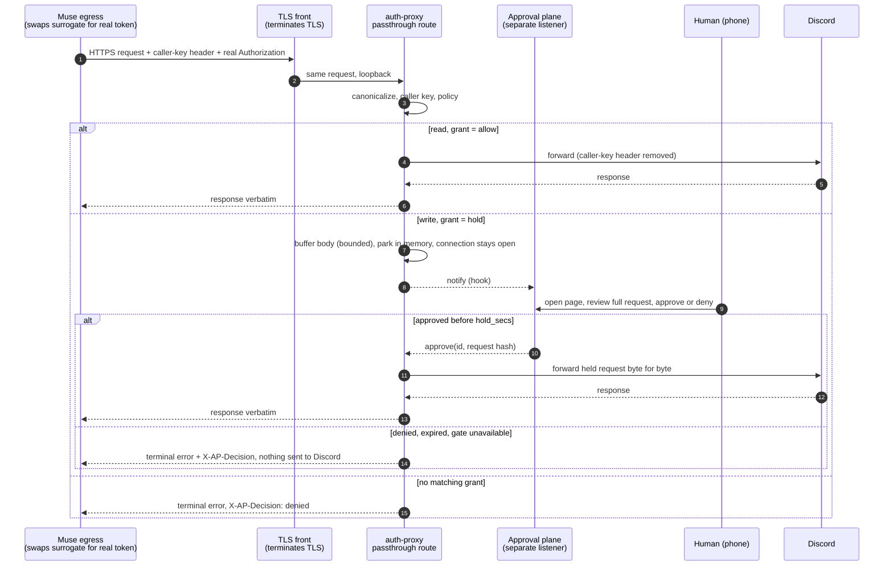

# Muse gated passthrough: a hold-the-connection approval gate

Status: design only, no code. Branch `design/muse-gated-passthrough`, based on `main` at the merge of
PR #11 (`b3f7864`). Scope: a minimal proof of concept (PoC) for one consumer, Muse calling the Discord
HTTP API through auth-proxy in standalone service mode.

This document supersedes, for this PoC only, two earlier sketches: the "platform vault path" in the
README Deployment models section, and the parked-and-polled design in
[#5](https://github.com/openabdev/auth-proxy/issues/5). It does not change Phase 1.

## How claims are labelled

- **[M]** measured: run or seen in output during this design work. The tag names what was run.
- **[I]** inferred from code or docs. The tag names the file or issue, e.g. `[I forward.rs]`.
- **[A]** assumed. Includes facts stated by the owner about Muse (written `[A owner]`), and anything about
  Muse or Discord that this repository cannot show. An `[A]` claim is a risk until someone checks it.

Statements of the form "the PoC does X" are design proposals and carry no tag.

## 1. Requirements

Stated by the owner and treated as fixed [A owner]:

1. A user creates a Muse custom connector for the gated Discord API. The connector points at our base URL
   and carries a header with a key (the caller key). Muse's custom connector always routes to us.
2. Muse replaces its own surrogate with the real Discord credential **before** the request reaches us.
   The request arrives with the real `Authorization` header. We never swap and never store a credential.
   We only decide pass or no-pass.
3. The request is the full Discord HTTP request. Policy per identity: reads (`GET` on allowed prefixes)
   pass immediately. Writes (for example `POST /channels/{id}/messages`) are held.
4. For a held request the proxy holds the connection until the human approves on the phone. It then
   forwards the held request byte for byte to Discord and returns Discord's response verbatim (status,
   headers minus hop-by-hop, body). Muse needs no approval proof or token.
5. On deny or timeout the proxy returns a terminal error that Discord's own responses cannot be mistaken
   for (distinct status and an `X-AP-Decision: denied|expired|unavailable` header) and sends nothing to
   Discord.
6. The connection is the state. There is no durable approved state, no polling endpoint and no one-time
   proof. A crash after approval and before forwarding loses the held connection, nothing executes, and
   Muse's retry starts a new approval round.

## 2. Overview



The caller path (Muse to the public listener) and the approval path (human to the approval listener) never
share a listener, a credential, or a router (section 3.6).

## 3. Design

### 3.1 Request handling in a passthrough route

A passthrough route is a route whose host is fixed in configuration, whose request carries the real
credential from the caller, and which has no credential store entry. The pipeline for a passthrough route
reuses Phase 1 steps 1 to 3 and 6 and skips steps 4, 5 and 7 [I phase1.md section 4; pipeline.rs]:

1. Refuse `CONNECT` (405) and `Upgrade` (501), as in Phase 1 [I pipeline.rs `handle`].
2. Canonicalize: origin form, one `Host`, no ambiguous path (section 3.8).
3. Read the caller key from the header (section 3.2), find the identity by constant-time hash compare.
4. Evaluate policy for identity, route, method and route-relative path. Result is `allow`, `hold` or deny.
5. `allow`: forward now. `hold`: section 3.4. Deny: terminal error (section 3.5).
6. One audit record per request, extended with the hold transitions (section 3.9).

The upstream host comes only from the route configuration, never from the request. The forwarder keeps
its Phase 1 properties: rustls with SNI equal to the route host, no redirect following, so a 3xx from
Discord goes back to Muse unchanged [I forward.rs `client_builder`].

Route addressing. Muse is given a base URL. The PoC proposes `https://<public-host>/pt/<route>/<discord
path>`, so the Discord path after `/pt/<route>` is forwarded unchanged (for example `/api/v10/channels/...`).
Whether a Muse connector accepts a base URL with a path prefix is unknown [A]; see open question 4.

Headers forwarded upstream (passthrough):

- Forward every inbound header except: the caller-key header, any other `x-ap-*` header, hop-by-hop
  headers and headers named by `Connection`, and `Host` (set to the route host, which necessarily differs
  from what Muse sent).
- `Authorization` and every other credential header are **kept**. This is the difference from Phase 1,
  where `strip_request_headers` removes all of `AUTH_HEADERS` before the swap [I headers.rs].
- `Content-Length` is set from the buffered body for held requests and from the declared length for
  allowed requests. A chunked inbound body is forwarded with a length. The body bytes are unchanged; only
  framing, which is hop-by-hop, differs.
- More than one `Authorization` header on a held route is refused (400, `X-AP-Decision: denied`), because
  a gate cannot say which one Discord will read. [A] that Discord reads only one.

A request to a held route with no `Authorization` header is refused before it reaches the human
(`credential_missing`). The human is not asked to approve a request Discord will reject with 401, and
the audit record shows that Muse's swap did not happen. Open question 9 asks the owner to confirm.

### 3.2 Caller key in a header (open point a)

Phase 1 puts the caller key in the path, `/ap/<caller-key>/...` [I canon.rs `parse_ap_path`]. The Muse
case needs it in a header, because the connector holds a header value and the path belongs to Discord.
`Authorization` cannot carry it, since that header holds the real Discord credential [A owner].

Proposal: a dedicated header, default name `X-AP-Caller-Key` (configurable, since the Muse connector's
constraints on header names are unknown, open question 2). Value format is unchanged: `apk_` plus 64
lowercase hex, checked by the existing `is_caller_key` [I canon.rs].

What is better than the path:

- A path key appears in every access log, proxy log and URL display on the way. A header key does not
  appear in a URL.
- Phase 1 audit has no field that can carry a caller key or query [I audit.rs doc comment]; the same
  holds for a header if the controls below are applied.

What is worse, and the control for each:

| Risk | Control |
|---|---|
| Header values appear in debug dumps, panics, and the TLS front's logs | Mark the value sensitive on ingest (`HeaderValue::set_sensitive`, which the `http` crate prints as `Sensitive` [I http crate docs]). Never log request headers. Implement `Debug` by hand on any struct that holds headers. Configure the TLS front not to log headers [A]. |
| The key could be forwarded to Discord | Remove it in the passthrough header builder, by name, and also remove every `x-ap-*` header. Acceptance test: a mock upstream echoes received headers and must not see the key (section 7). |
| Timing side channel on compare | Reuse `caller_identity`: hash the presented key with sha256, then compare against every identity with `ConstantTimeEq`, so time does not show which identity matched [I pipeline.rs `caller_identity`]. |
| Duplicate or malformed header | Two values, or a value not matching `apk_<64 hex>`, is `caller_rejected`, never a guess at which value counts. |
| Key in the Muse connector configuration | Out of our control [A]. The key is a 256-bit random value, revocable by deleting the identity from the policy file (hot reload exists [I pipeline.rs `App::policy`]). |

The caller key authenticates the connector to the gate. It is not a Discord credential and not an
approval credential.

### 3.3 Policy: a third verdict, and segment patterns

Phase 1 policy answers allow or deny. A grant is `{identity, credential, route, methods, paths}` with
prefix matching on `paths` [I policy.rs `evaluate`; config.rs `Grant`]. Two changes are needed:

1. **Verdict.** A grant gains `decision = "allow" | "hold"`. A passthrough grant has no `credential`
   (today `credential` is a required field [I config.rs `Grant`]). If more than one grant matches, `hold`
   beats `allow` (the stricter wins). No match is deny, as today.
2. **Exact segment patterns for writes.** Prefix matching cannot say "`POST /channels/{id}/messages` and
   nothing under it". A prefix `/api/v10/channels/` would also match `POST /api/v10/channels/1/messages/2/reactions`
   and every other POST below it. Add `path_patterns`, where each segment is a literal or `*` (exactly
   one non-empty segment, no `/`), matched against the whole path with no prefix semantics. Reads may keep
   prefix `paths`. [A] This is the only policy-language extension the PoC needs.

Example, for the identity of one Muse connector (names are illustrative):

```toml
[[route]]
name = "discord"
host = "discord.com"
mode = "passthrough"

[[grant]]
identity = "muse-alice"
route = "discord"
methods = ["GET"]
paths = ["/api/v10/channels/", "/api/v10/guilds/", "/api/v10/users/@me"]
decision = "allow"

[[grant]]
identity = "muse-alice"
route = "discord"
methods = ["POST"]
path_patterns = ["/api/v10/channels/*/messages"]
decision = "hold"
```

Everything else, including `PUT`, `PATCH`, `DELETE` and `POST` to other paths, is denied.

### 3.4 The hold

Sequence for a `hold` verdict:

1. Decide on method and path before reading the body. A denied request is answered without reading the
   body, and the connection is closed.
2. Read the body into memory, bounded by `held_body_max_bytes` and by `body_read_secs`. Over the cap is
   413 with `X-AP-Decision: denied`; the request is not held.
3. Require `Content-Encoding` absent or `identity`. A compressed body cannot be shown to the approver as
   the bytes Discord will decode. [A] Muse does not compress requests; if it does, the answer is deny,
   not decompress.
4. Compute the canonical request digest: sha256 over method, route name, raw path, raw query and body
   bytes (length-prefixed fields). This is the hash the approver signs off on. It binds approval to the
   exact bytes held, as #5 requires [I issue #5, "approval must bind to exactly what will be sent"]. With
   an in-memory immutable entry the hash cannot drift, but it is cheap and it lets the approval API
   refuse an approve call that names a stale id.
5. Insert the entry in the in-memory table (section 3.7), write the `held` audit record, fire the
   notification, and await a one-shot decision with a timeout of `hold_secs`.
6. The entry is a state machine guarded by one mutex: `Pending` to exactly one of `Approved`, `Denied`,
   `Expired`, `Abandoned` (caller disconnected). The first transition wins. This is single execution:
   a held request cannot be approved twice, because `Approved` is not re-enterable.
7. On `Approved` the handler itself builds the upstream request from the held bytes and sends it. The
   forward runs in the handler's task, not in a detached task. If Muse drops the connection before the
   forward starts, the handler future is dropped and nothing is sent. If the drop happens during the
   forward, the request may already be at Discord; the audit shows `forward_started` without
   `completed`.
8. Discord's response streams back unchanged, as for an allowed request [I pipeline.rs step 9].

What the approver sees is the same bytes that will be sent, not a re-rendered form. The page shows the
method, route, raw path, raw query, content type, body size and body as escaped text (never as HTML), and
the digest.

### 3.5 Outcome contract

Anything that did not come from Discord carries `X-AP-Decision` and a small JSON body
`{"ap_decision": "...", "code": "..."}`. Discord's response never carries `X-AP-Decision`, and the proxy
removes any `x-ap-*` header from the upstream response, so the marker cannot be spoofed by the far side.

| Case | Status (proposed) | `X-AP-Decision` | Sent to Discord |
|---|---|---|---|
| Human denied, or no grant matches, or caller key rejected, or body over cap | 423 | `denied` | nothing |
| `hold_secs` elapsed with no decision | 410 | `expired` | nothing |
| Gate cannot decide: policy unavailable, hold table full, shutting down, upstream connect failure after approval | 503 | `unavailable` | nothing |
| Allowed or approved and forwarded | Discord's own | absent | the request |

Why these statuses: Discord's documented API statuses are 2xx, 304, 400, 401, 403, 404, 405, 429 and some
5xx [A, not checked in this work], so 423 and 410 are not expected from Discord, while 403, 404 and 503 are.
The header is the authoritative marker. The status is a second signal, so a client that ignores headers
still sees something unusual. Whether Muse reacts badly to unusual statuses is unknown (open question 5).

Two behaviours follow from "terminal":

- No `Retry-After` header and no hint that the same request may succeed later. An expired request is a
  recorded refusal, not a state to poll [I issue #5 comment, "expiry is a verdict, not a state"].
- A failure after the forward began, for example Discord resets the stream, closes the client connection
  without a synthetic success, as Phase 1 does [I phase1.md section 4, "Upstream error mid-stream"].

### 3.6 Approval plane (open point e)

Requirement: it is authenticated independently of caller keys, and neither the agent nor Muse has a path
to it.

Structure, the same in every option below:

- A separate listener, separate router, separate credential. The public (caller) router does not mount any
  approval route, and the approval router does not accept a caller key. Nothing routes from one to the
  other except the in-process hold table.
- The approver credential is a different secret, stored only as a hash, unrelated to any caller key.
- Muse's egress can reach the public listener. It must not be able to reach the approval listener. That is
  a network property, not a code property; the acceptance test in section 7 checks it from the caller
  path.

Options for how the human reaches it, none built here:

| Option | How | Pros | Cons |
|---|---|---|---|
| A. Local CLI on the proxy host | Unix socket with mode 0600, CLI over SSH | Smallest. No new network listener. Reuses `bind_unix_socket` [I listener.rs] | Not "on the phone" unless the phone has an SSH client |
| B. Minimal web page on a private-network listener | `GET /pending`, `GET /pending/<id>`, `POST /pending/<id>/approve\|deny`, approver bearer token, bound to a private-network or loopback address behind the owner's private network | Phone-friendly. Works with any browser. Client-agnostic API, in line with the #6 decision that PWA and native app are thin shells over the same endpoints [I issue #6 comment 1] | A bearer token on a phone browser is weaker than a device-bound key. Needs CSRF protection and strict output escaping |
| C. B plus the owner's existing notification channel | The hold fires a webhook to an existing notifier; the notification carries a link to B's page and a one-line summary only | No new notification surface. Issue #6 names an existing display daemon as the first consumer [I issue #6 comment 2] | A display is not a reliable push when the phone is locked [I issue #6 comment 2, stated limitation] |
| D. B with WebAuthn approve | Passkey assertion over the request digest | Strongest, approver key never leaves the device [I issue #6 comment 1] | Largest build. Not for the PoC |

Recommendation for the PoC: B with C's notification. Keep the HTTP API client-agnostic so D can replace
the bearer step later. Controls for B: the approver token is compared in constant time against a stored
hash; the page sets `Content-Security-Policy: default-src 'none'` with only what it needs and renders
the body with escaping; `approve` and `deny` are `POST` and require the approver token in a header, not a
cookie, so CSRF does not apply; the page never renders or logs an `Authorization` value from a held
request (the entry keeps it for forwarding but the view model omits it). The page shows that an
`Authorization` header is present, not its value.

An unreachable approval plane is not a special case. Holds expire as `expired` after `hold_secs`. The
gate fails closed in time as well as in space [I issue #5 comment 1, point 3].

### 3.7 Concurrency and resource limits (open point f)

The public listener faces a network, which the Phase 1 agent listener does not. Today the proxy has no
connection cap and no header-read timeout on that listener: a search of `crates/ap-proxy/src` and
`crates/ap-core/src` for `timeout`, `Semaphore`, `ConcurrencyLimit` and `header_read` finds only the
upstream client's connect and idle timeouts [M grep over those two source trees]. The listener runs
HTTP/1.1 only (`axum` with the `http1` feature) [I crates/ap-proxy/Cargo.toml]. So a remote listener needs
these limits added. Proposed defaults, all configurable [A, values are starting points]:

| Limit | Default | Behaviour on exceed |
|---|---|---|
| `max_connections` on the public listener | 256 | accept then close, as `ap-egress` does [I config.rs `Egress.max_connections`] |
| `header_read_secs` | 10 | close |
| `body_read_secs` (held and allowed bodies) | 15 | answer 503 `unavailable` and close, nothing held or sent |
| `held_body_max_bytes` | 1 MiB | 413, `denied`, not held |
| `max_held_total` | 32 | 503, `unavailable`, not held |
| `max_held_per_identity` | 4 | 503, `unavailable`, not held |
| `holds_per_identity_per_minute` | 10 | 503, `unavailable`, not held. Bounds how often a retrying Muse can prompt the phone |
| `hold_secs` | 120 (range 5 to 600) | `expired` |
| TCP keepalive on accepted sockets | on | keeps idle NAT and middlebox state alive during a hold |

Memory bound: `max_held_total` times `held_body_max_bytes` is 32 MiB, plus headers.

The hold timeout interacts with every idle timeout between Muse and the gate: the TLS front's read
timeout, any load balancer, and Muse's own client timeout. The effective window is the minimum of all of
them, and only `hold_secs` is ours [A]. Section 8 asks the owner to measure it, and stage 1 includes a
probe for exactly this (section 7).

Shutdown: on SIGTERM the proxy answers every held request `unavailable` and exits. On crash the OS resets
the sockets (section 5).

Held entries live in process memory only. Nothing about a held request, including headers, is written to
disk, to the audit stream, or to a core dump (set `RLIMIT_CORE` to 0 at startup) [A].

### 3.8 Canonicalization for policy matching (open point g)

Reuse Phase 1, and add the few rules a remote, header-keyed, write-capable route needs.

Reused unchanged [I canon.rs; pipeline.rs `handle`]:

- Origin form only; exactly one `Host`; no userinfo (`check_origin_form`).
- `path_ambiguous` on the raw, still-encoded path: refuses `.` and `..` segments, empty interior
  segments, `%2e`, `%2f`, `%5c`, `%00`, backslash and `%25` followed by `2e` or `2f`.
- Matching runs on the raw wire form. No layer decodes before policy sees the path ("No decoding layer may
  disagree with the policy check about what a path is" [I canon.rs module doc]).

Added for passthrough:

1. **Expected `Host`.** `check_origin_form` compares `Host` with the listener's own bind address
   [I pipeline.rs `listen_authority`]. A remote listener behind a TLS front sees the public name, so the
   passthrough listener takes a configured `public_authority`.
2. **No second decode.** The path forwarded upstream is the same raw string the policy matched, and the
   query is forwarded raw. Because the policy is an allow list with default deny, an encoding the policy
   does not recognize fails to match and is denied; it cannot turn a write into a read.
3. **Percent-encoded unreserved characters** (a `%` followed by two hex digits that decode to a letter,
   digit, `-`, `.`, `_` or `~`) are refused with `path_ambiguous`. Discord paths do not need them, and a
   legitimate emoji reaction path uses encoded non-ASCII bytes, which stay allowed [A].
4. **Method** is the exact received token; only listed methods match; `HEAD` and `OPTIONS` need a grant.
5. **Path patterns** are matched whole-path, segment by segment (section 3.3). Query is not part of the
   match, and is shown to the approver.
6. **Body size cap** per section 3.7 before policy returns `hold`. An `allow` request keeps the Phase 1
   cap `limits.max_body_bytes`, default 32 MiB [I config.rs `Limits`].
7. **`Content-Encoding`** on a held request must be absent or `identity`.
8. **Duplicate security-relevant headers** (caller key, `Authorization`) are refused, not merged.

### 3.9 Audit

Phase 1 writes one line per request with no field for a key, credential or query [I audit.rs]. The
passthrough mode adds fields and transitions, and keeps that property:

- Transitions for a held request: `held`, `approved` or `denied` or `expired` or `abandoned`,
  `forward_started`, `completed`. Each carries the request id, identity, route, method, route-relative
  path without query, the digest, and for decisions the approver identity.
- `auth_present` (boolean) and `auth_scheme` where the scheme is one of `Bot`, `Bearer` or `other`. The
  scheme is taken only if it matches that fixed list. A header value with no scheme would otherwise put
  the secret in the first token. This gives stage 1 evidence that Muse's swap happened without logging
  the token.
- No header value of any kind, no query, no body.
- The `forward_started` record is written before the upstream request is sent. If that write fails, the
  held request is not forwarded (`unavailable`). This keeps the lesson from the issue #5 discussion that
  the record precedes the action [I issue #5 comment 1, point 1], without a hash chain.

Phase 1's audit sink is stdout and a failed write does not refuse a request [I phase1.md section 4,
"Audit write failure"]. The `forward_started` rule above is the one place the PoC makes the write
load-bearing.

## 4. Trust model changes (open points b and c)

### 4.1 The Phase 1 invariant that no longer holds

Phase 1: the real credential never leaves the proxy; the agent holds only a surrogate [I phase1.md;
issue #5, "Security invariants"]. In this mode **the real Discord token transits our service**, in the
clear after TLS termination, in every request. It is held in memory for up to `hold_secs` for held
requests. The gate is no longer a credential custodian. It is a decision point on a path that carries the
credential.

What still holds: the agent that talks to Muse does not hold the credential (Muse's egress swaps it in
[A owner]), and a write reaches Discord only after a human approves it.

### 4.2 Compensating controls (required for the PoC)

1. **Encrypted remote leg only.** Either Muse reaches the gate over the owner's private network, or over
   public TLS. The proxy keeps `bind_loopback`, which refuses any non-loopback bind [I listener.rs], and a
   TLS terminator on the same host (a reverse proxy or a tunnel agent) forwards to loopback. No plaintext
   listener on a non-loopback address. This keeps the existing code invariant intact and avoids adding a
   TLS server stack to the proxy. If the owner prefers native TLS in the proxy, that is a new code path
   and a new `bind_remote` that requires a certificate. Caveat: **whoever terminates TLS sees the token**.
   A self-run terminator is inside the trust boundary. A managed third-party tunnel is not, and the owner
   should decide whether that is acceptable (open question 3).
2. **Redact credentials everywhere.** `Authorization`, `Cookie`, `Proxy-Authorization`, the caller-key
   header and the rest of `AUTH_HEADERS` [I headers.rs] are never written to audit, error bodies, logs,
   panic messages or debug output. Concretely: sensitive-marked header values, hand-written `Debug` for
   held entries and request wrappers, error bodies built from fixed strings (as `Code::message` is
   [I error.rs]), no request-header logging in the TLS front, core dumps off, and panic handling that
   does not print request data.
3. **Held requests in memory only, bounded.** Count, size and lifetime as in section 3.7. Nothing is
   persisted. On shutdown the table is dropped.
4. **Fail closed.** Unknown, unavailable or full means refuse, with `X-AP-Decision: unavailable`, and
   nothing is sent to Discord. Policy unavailable is 503 as in Phase 1 [I pipeline.rs].
5. **Fixed upstream.** The upstream host is route configuration, TLS-verified, with no redirects followed
   [I forward.rs]. A caller cannot aim the token at another host.
6. **Reduce what a leaked token can do.** This is outside the gate and listed for completeness: use a bot
   token scoped to the channels the connector needs, and rotate it if the gate host is ever suspected.

### 4.3 What this gate does not protect against (open point c)

The gate protects against the agent: a prompt-injected or mistaken agent behind Muse cannot cause a
write to Discord without the human approving it, provided the agent can only act through the connector.

It does **not** protect against the Muse platform itself. Muse's egress holds the real Discord token (it
performs the swap before we see the request [A owner]). Muse, or anyone who compromises Muse's egress,
can call Discord directly and skip the gate. The same applies to anything that can read the token out of
Muse's vault. The gate is a policy checkpoint for a cooperating platform, not an enforcement point
against a hostile one. The README and any user-facing text for this mode should say so in the same
words.

In Phase 1 the same boundary is enforced by the network (per-UID iptables, loopback only) [I README,
Deployment models]. This mode has no equivalent, because Muse is not inside our network.

## 5. The connection is the state: failure analysis and comparison with #5

### 5.1 Failure analysis

| Event | Result | Nothing executes? |
|---|---|---|
| Crash or restart while held, before approval | Sockets reset. Muse sees a connection error. Retry starts a new round | yes |
| Crash after approve, before forwarding | The approval is lost with the process. Muse sees a connection error | yes |
| Crash after the forward began | Discord may or may not have the request. Muse sees an error. A retry starts a new round and the human sees a second prompt | no, possibly executed once |
| Muse drops the connection while held | Entry becomes `Abandoned`. A later approve call is refused as `gone` | yes |
| Approve races a Muse disconnect | First transition wins. If `Approved` wins and the handler is dropped before the send, nothing is sent | yes, unless the send started |
| `hold_secs` elapses | `expired`, 410, nothing sent | yes |
| Approval plane down | Holds expire | yes |
| Discord returns 429 or 5xx after approval | Returned verbatim. A Muse retry means a new approval | already executed or rejected by Discord |

Exactly-once is not claimed. The PoC gives **at most one forward per held connection** and **no forward
without an approval in the same process lifetime**. Duplicate delivery is possible only through the
sequence "forwarded, response lost, Muse retries, human approves again". Cheap mitigations, both optional:
the approval page shows when an identical digest was forwarded in the last few minutes (an in-memory ring,
lost on restart), and Discord's message `nonce` with `enforce_nonce` can make Discord itself drop a
duplicate [A, Discord behaviour not checked here].

### 5.2 Comparison with #5's durable design

Issue #5 parks requests in a durable store, returns a request id, lets the caller poll or take a callback,
executes after approval, and records the result against the id [I issue #5, sections 2 and 4]. Each of
those exists because the caller does not wait. Here the caller waits, so the reasons mostly disappear.

| #5 element | Keep for this PoC? | Why |
|---|---|---|
| Third verdict `require_approval` in per-identity policy | **Keep** (named `hold`) | Core of the feature |
| Fail closed, unknown approval state never executed | **Keep** | Free with in-memory state |
| Canonicalized request, approval bound to its hash | **Keep** | Cheap, and keeps the approve-what-you-see property |
| Separate approval plane, independent of caller keys, no agent path | **Keep** | The central security property |
| Notification hook on park | **Keep** | Without it the human does not know to look |
| Audit transitions `held/approved/denied/expired/executed` | **Keep**, rename `executed` to `forward_started` and `completed` | Same purpose; the record precedes the action |
| Expiry as a recorded terminal refusal, not a state | **Keep** | Matches the connection model directly |
| Single execution | **Keep** as at-most-once per connection (section 5.1) | In-memory state machine, no store |
| WebAuthn approval | **Defer** | Part of the end state in #6. The PoC uses an approver token over a private path |
| Durable pending store surviving restart | **Drop** | The connection is the state. A restart loses it and that is the specified behaviour |
| "Consume approval and mark executed in one durable write" (restart-safe exactly once) | **Drop** | Nothing to recover. After a restart there is no approved id to re-execute |
| Request id and polling endpoint, callback | **Drop** | The response is the connection's own response. The request id remains, as an audit and approval-page key only |
| Result slot recorded against the id | **Drop** | Discord's response goes straight back on the connection |
| One-time approval proof (platform vault path) | **Drop** | Muse needs no proof; owner decision |
| Credential store and swap in the proxy | **Drop for this mode** | The credential arrives with the request |
| Session revocation drops parked requests | **Replace** | No sessions. Removing an identity from the policy file drops its held requests as `unavailable` on reload |
| Batch approval, "approve this route for N minutes" lease | **Drop** | Open questions in #5; the default answer there was already no |
| Hash-chained audit store | **Drop** | Not needed for a PoC. Revisit if the audit must be tamper-evident |

What the PoC loses, stated plainly: any request that is in flight across a restart is lost and must be
re-approved; there is no way for an approver to approve something after Muse has given up; and the human
cannot batch.

## 6. What changes compared with Phase 1

All of these are changes to code that exists on `main` [I, files cited].

**Needed:**

1. **A `passthrough` route mode in the forwarder.** A route field `mode`, default `swap` (today's
   behaviour). A header builder that keeps `Authorization` and strips only the caller-key header, other
   `x-ap-*` headers, hop-by-hop headers and `Host` (today `outbound_headers` strips `AUTH_HEADERS` and
   sets one credential header [I forward.rs, headers.rs]). A response filter that also removes `x-ap-*`.
2. **Header-borne caller key** in place of `/ap/<caller-key>/<route>/...` [I canon.rs `parse_ap_path`],
   with route addressing `/pt/<route>/...` (section 3.1).
3. **A remote-reachable listener.** Today `bind_loopback` refuses non-loopback addresses [I listener.rs].
   The PoC keeps that and fronts it with a TLS terminator; a `public_authority` setting replaces the bind
   address in the `Host` check [I pipeline.rs]. Add connection cap, header and body read timeouts, and TCP
   keepalive (section 3.7).
4. **Policy:** `decision` on grants, optional `credential`, `path_patterns` (section 3.3). Config
   validation must reject a passthrough route that also appears in a credential's `routes`, and a swap
   route grant with `decision = "hold"` unless stage 2 supports it there too.
5. **Startup without the session machinery.** `App::new` builds a registry and requires the session
   expiry store, and `run` exits with code 2 if it is missing [I pipeline.rs `App::new`; lib.rs `run`]. A
   passthrough-only deployment should not need them.
6. **Outcome contract:** the `X-AP-Decision` header and body for refusals (section 3.5); new refusal
   codes alongside the Phase 1 table [I error.rs].
7. **Stage 2 only:** the hold table, the approval listener and router, the notification hook, the
   extended audit.

**Not needed for this mode:**

- Credential store and broker (`FileStore`, `--secret-root`) [I lib.rs `run`].
- Registrar and runtime: session plane, session socket, admin socket, Ed25519 hello proof, nonce table,
  surrogate registry, token directory, lease and expiry store [I README Features; session-plane.md].
- `ap-egress`, the CONNECT allowlist, and the per-UID iptables pod layout.
- `ap-client`, `ap-runtime-shim`.
- Per-route `credential_scheme` ([#12](https://github.com/openabdev/auth-proxy/issues/12)). It exists
  because the swap path hard-codes `Bearer` [I forward.rs `credential_value`; issue #12]. In passthrough
  mode the scheme is whatever Muse sends, so #12 does not block this PoC.

## 7. Staged plan and acceptance tests

Tests use the mock-upstream approach of the existing fail-closed matrix (`tests/matrix`, with the
`matrix-upstream` build feature) [I README Features; lib.rs]. The mock upstream records every request it
receives, including header names, and the tests assert on that record.

### Stage 1: allow or deny passthrough (reads pass, writes denied)

Goal: validate Muse's hook format end to end with no approval machinery. A write that would later be
`hold` is simply denied. Stage 1 contains items 1 to 3 and 5 to 6 of the "needed" list, and the
`decision = "allow"` half of item 4.

Evidence to collect from a real Muse connector run (names only, never values): which header carries the
key, whether `Authorization` arrives, with which scheme class (`Bot`, `Bearer`, `other`), the `Host`
header and path prefix, HTTP version at the TLS front, whether bodies are chunked or compressed, whether
Muse sends other headers we would forward. A header-names-and-lengths debug record, off by default, is
the tool for this. It never prints values.

Acceptance:

1. A `GET` on an allowed prefix with a valid caller key reaches the mock upstream and its response comes
   back unchanged (status, headers minus hop-by-hop, body).
2. A `POST /channels/{id}/messages` is denied with the distinct status and `X-AP-Decision: denied`, and the
   mock upstream records no request.
3. Missing, duplicate and malformed caller-key headers are `caller_rejected` with `X-AP-Decision: denied`,
   nothing upstream.
4. **Caller-key header stripped upstream:** the mock upstream's recorded headers contain neither the
   caller-key header nor any `x-ap-*` header, for allowed requests.
5. **`Authorization` forwarded unchanged:** the mock upstream receives the identical `Authorization` value
   that the test sent.
6. **`Authorization` never in any log:** run the proxy with a sentinel token, exercise allow, deny, 413,
   malformed, upstream-failure and panic-injection paths, and assert the sentinel and the caller key are
   absent from stdout, stderr and the audit stream. (Phase 1 has the same discipline for surrogates and
   credentials [I audit.rs].)
7. Path rows from the existing matrix pass unchanged on a passthrough route: `..`, `%2e`, `%2f`, `//`,
   `%25 2e`, plus the new "percent-encoded unreserved character" row.
8. A listener bound to a non-loopback address is refused at startup (`bind_loopback` behaviour kept).
9. Public-listener limits: connection cap, header-read timeout and body-read timeout each close the
   connection and leave the proxy serving others.
10. **Hold-tolerance probe (answers open question 1):** a test-only route that returns 200 after N seconds,
    with N configurable per request from a small fixed set (10, 30, 60, 120, 300). Run from the real Muse
    connector and record the largest N that completes. This is the only stage 1 item that adds code beyond
    allow and deny, and it is removed or disabled before stage 2 ships.

### Stage 2: held-connection approval

Adds the hold table, the approval listener, the notification hook and the `hold` verdict. Acceptance:

1. **Held request not forwarded until approval:** a `POST` held for 5 s with no approval has produced zero
   requests at the mock upstream; after approve, exactly one request arrives.
2. **Byte for byte:** the body, method, path, query and every forwarded header the mock upstream records
   equal what the test sent, except `Host`, hop-by-hop headers and the removed caller-key header.
3. **Verbatim response:** the held connection's response equals the mock upstream's response (status,
   headers minus hop-by-hop, body), including a non-2xx.
4. **Deny sends nothing upstream:** after deny, the caller gets `X-AP-Decision: denied` and the mock
   upstream recorded no request.
5. **Expiry sends nothing upstream:** with `hold_secs` set low, the caller gets `X-AP-Decision: expired` at
   about `hold_secs`, no `Retry-After`, no upstream request.
6. **Unavailable sends nothing upstream:** table full, per-identity cap, per-minute rate cap, policy file
   removed, and SIGTERM during a hold each give `X-AP-Decision: unavailable`, no upstream request.
7. **Single execution:** two concurrent approve calls for one id produce one upstream request and one
   refused call. Approve after expiry, after deny and after caller disconnect is refused.
8. **Caller disconnect while held** marks the entry `Abandoned` and frees its slot; a later approve is
   refused and nothing is sent.
9. **Crash while held executes nothing:** kill -9 the proxy with one request held; the caller sees a
   connection error; restart the proxy; the mock upstream has no request and the approval plane lists no
   pending entries.
10. **Crash after approve, before forward executes nothing:** inject a pause between the `Approved`
    transition and the send, kill -9 during it, restart: no upstream request, no pending entry, and a
    caller retry starts a fresh hold.
11. **Approval plane unreachable from the caller path:** from the network position of Muse's egress (the
    public listener and the TLS front), connection to the approval listener's address and port fails, and
    no approval route exists on the public router (404 for every approval path with a valid caller key).
    A caller key is refused on the approval listener, and the approver token is refused on the public one.
12. **`Authorization` never in any log or approval page:** the stage 1 sentinel test, extended with hold,
    approve, deny, expire and abandon paths, and with the approval page body and its notification payload.
13. **Caller-key header stripped upstream** for forwarded held requests (stage 1 item 4, repeated).
14. **Bounds hold:** with `max_held_total` holds in place, the next request is `unavailable`, and resident
    memory stays under the computed bound.
15. **Body rules:** a held body over `held_body_max_bytes` is 413 `denied` and not held; a compressed body
    is `denied`.
16. **Audit:** the `forward_started` record is present before the upstream request in the mock's timeline;
    if the audit sink is made to fail, the held request is not forwarded.

## 8. Open questions for the owner

1. **Muse's tolerance for a held connection (open point d).** How long will the Muse custom connector wait
   for a response: its client timeout, any platform gateway timeout, and whether it retries on timeout
   or on a dropped connection? This is unknown [A]. The PoC makes `hold_secs` configurable (default
   120, range 5 to 600) and stage 1 item 10 measures it. Until measured, treat 120 s as a guess. The TLS
   front's own idle timeout also bounds the window and must be configured to at least `hold_secs`.
2. **Caller-key header name.** Can the connector set an arbitrary header name, and does it constrain the
   name or value format? Default `X-AP-Caller-Key` is a guess [A].
3. **How does Muse reach the gate, and who terminates TLS?** Private network or public TLS endpoint? If a
   managed tunnel terminates TLS, that provider sees the Discord token. Is that acceptable, or must TLS
   terminate on a host the owner runs (or natively in the proxy)?
4. **Base URL shape.** Does the connector accept a base URL with a path prefix, such as `/pt/discord`,
   or must the gate sit at the root and serve one route?
5. **Status codes for the terminal errors.** The proposed 423, 410 and 503 are untested against Muse
   [A]. Does Muse treat unusual statuses or non-Discord bodies as a connector failure, retry on them, or
   show them to the agent?
6. **Retry behaviour.** After an `expired` or `denied`, does Muse's agent retry automatically? If so each
   retry is another phone prompt; the per-minute cap bounds this, but the owner may prefer a lower cap or
   a cooldown after a deny.
7. **Approver channel.** Is option B with C's notification acceptable for the PoC, with a bearer approver
   token on the phone, deferring WebAuthn? Which notifier should the hook target?
8. **One caller key per what?** One identity per Muse user, per connector, or per Discord channel set?
   This sets how revocation and the audit identity read.
9. **Missing `Authorization` on a held route.** Refuse before bothering the human (proposed), or hold it
   anyway?
10. **Policy scope for the pilot.** The exact allow prefixes for reads and the exact write patterns (only
    message create, or also replies, reactions, edits, deletes)?
11. **Accepting the stated limit.** Section 4.3: the gate does not constrain Muse's own egress, which
    holds the token. Is that acceptable for the pilot, and is the user-facing wording agreed?
12. **Does Muse send request bodies compressed or with a non-JSON content type** (for example multipart
    attachments)? Multipart uploads can exceed `held_body_max_bytes`; are attachments in scope?

## 9. Evidence and method

Read from the worktree (`origin/main` at `b3f7864`, the merge of PR #11) [M `git log`]:

- Issues #5, #6 (with comments) and #12, via `gh issue view N --repo openabdev/auth-proxy --comments`.
- `docs/design/phase1.md` (labelling, section 4 pipeline and error contract, section 8), `README.md`
  (Deployment models, Features, Todos).
- `crates/ap-core`: `policy.rs`, `headers.rs`, `canon.rs`, `config.rs`, `audit.rs`, `error.rs`.
- `crates/ap-proxy`: `forward.rs`, `pipeline.rs`, `lib.rs`, `listener.rs`, and `Cargo.toml`.

Run: `git status`, `git log`, `ls`, and `grep` for `timeout`, `Semaphore`, `ConcurrencyLimit`, `header_read`
and `keepalive` over `crates/ap-proxy/src` and `crates/ap-core/src` [M]. No code was built or tested, and
nothing was run against Muse or Discord, so every statement about their behaviour is `[A]`.
