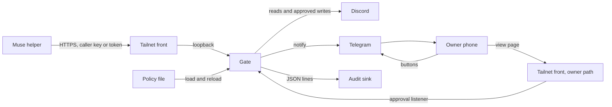
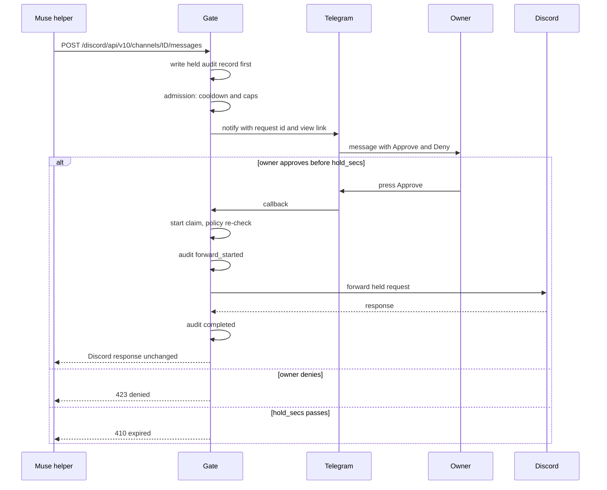
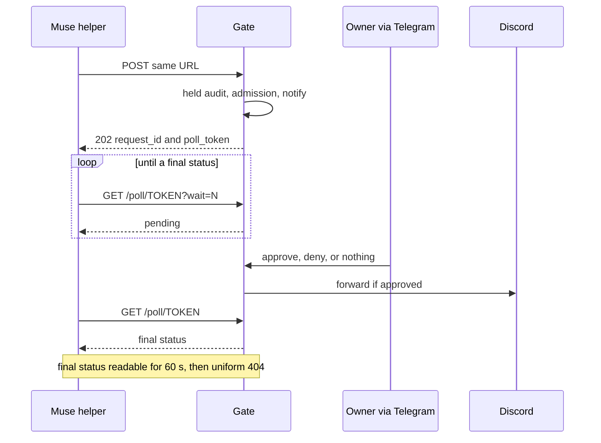

# Gated passthrough for Muse

An operator's summary of the Muse deployment. Every host, id and hash below is a placeholder. The reasoning
is in [muse-gated-passthrough.md](design/muse-gated-passthrough.md) and
[muse-async-poll.md](design/muse-async-poll.md). The step-by-step setup is in
[muse-stage2.md](runbooks/muse-stage2.md).

**Gated passthrough** is a route in passthrough mode where the caller's own credential is forwarded. The proxy
neither stores nor swaps credentials. Write requests are held until a human approves them on Telegram.
Stage 1 is passthrough with allow and deny only. Stage 2 is gated passthrough.

## 1. Who is who

- **Muse**: the caller. Its helper sends requests through a custom connector. Muse's egress replaces the
  connector's surrogate with the real Discord token before the request reaches the gate.
- **The gate**: one `auth-proxy` binary on one host, listening on loopback, behind a TLS front on the tailnet.
- **Discord**: the upstream (`discord.com`).
- **The owner**: approves or denies on Telegram.

The gate constrains the agent, not the Muse platform. Muse holds the real token, so Muse (or anyone who
compromises it) can call Discord directly and skip the gate ([runbook](runbooks/muse-stage2.md), top).

## 2. Architecture



The gate also long-polls Telegram for button presses. The approval and view listener is a second loopback
listener; the front must expose it only to the owner's devices.

## 3. Request flow, blocking mode



An admission refusal returns 503 (`cooldown`, `identity_cap`, `table_full`) and sends no notification. If the
`held` audit write fails the answer is 503 `audit_unavailable`. A deny or an expiry starts the cooldown.

## 4. Request flow, async polling mode



Final statuses: `approved_and_sent` (adds `discord_status`, `body` up to 64 KiB, `truncated`), `denied`,
`expired`, `dropped`, `send_failed`, `send_unknown`. `wait` is capped at 25 s, and an invalid value is 400.
There is no `Idempotency-Key`; Muse never retries a POST blindly.

## 5. Configuration

Placeholders only. Ranges are from `crates/ap-core/src/config.rs`.

```toml
version = 1

[listen]
proxy = "127.0.0.1:<port>"              # loopback only

[passthrough]
public_authority = "<public-host>"      # the Host the front passes through
hold_secs = 120                         # 5..=600, blocking routes
held_body_max_bytes = 1048576           # 1..=8 MiB
max_held_total = 32                     # 1..=1024
max_held_per_identity = 4               # 1..=max_held_total
cooldown_secs = 60                      # 0..=3600, 0 disables

[approval]                              # required when any grant holds
listen = "127.0.0.1:<approval-port>"    # loopback, not listen.proxy
user = "<approver>"
password_sha256 = "<sha256>"
public_base_url = "https://<owner-host>"

[notify]
kind = "telegram"
token_file = "/etc/<dir>/telegram-token"   # absolute, regular file, mode 0600
chat_id = "<chat-id>"
approval_url_base = "https://<owner-host>"
buttons = true
owner_chat_id = <owner-id>              # positive Telegram user id
view_base_url = "https://<owner-host>"  # serves /view/<token>

[[identity]]                            # keyed caller
name = "<caller>"
caller_key_sha256 = "<sha256>"

[[token_identity]]                      # option B pilot, one in total
name = "<pilot-name>"
route = "discord"
token_sha256 = "<sha256>"               # of the exact "Bot <token>" header value
expires = "<YYYY-MM-DD>"                # last UTC day accepted

[[route]]
name = "discord"
host = "discord.com"
mode = "passthrough"
hold_mode = "async"                     # default "blocking"
async_hold_secs = 120                   # 5..=600, async only

[[grant]]                               # reads pass
identity = "<caller>"
route = "discord"
methods = ["GET"]
paths = ["/api/v10/channels/", "/api/v10/users/@me"]

[[grant]]                               # writes are held
identity = "<pilot-name>"
route = "discord"
methods = ["POST"]
decision = "hold"
path_patterns = ["/api/v10/channels/*/messages"]
```

Notes: a hold grant uses `path_patterns`, never `paths`, and only on a passthrough route. Async needs a
passthrough route that has a hold grant, or the policy is refused at load. With `buttons = false`, setting
`owner_chat_id` or `view_base_url` is refused. A token identity authenticates keyless requests on its route,
only for a `hold` grant. Whether the Muse connector sends a caller key, a token, or both is not verified here.

## 6. Credentials and secrets

- **Stored by the gate**: a caller key hash, a token hash, an approver password hash. Never a token or key.
- **Telegram bot token**: read at startup from `token_file`. It must be a regular file with mode 0600, owned by
  the service user. Any other mode refuses to start.
- **Discord token**: lives in Muse's secure connector storage, entered by the owner. It reaches the gate only
  in the request's `Authorization` header and is forwarded, not kept.
- **Audit**: each held-request record has the request id, identity, route, method, path (query dropped), a
  request digest, the transition, status and timing. It never has a token, `Authorization`, hash or body.
  The Telegram message carries a fixed sentence, the request id and a link, not the content.

## 7. Operations

- **Deploy**: build one binary per commit, re-render the policy file, restart the service. The gate exits 2 on
  an invalid policy. Policy also hot-reloads; waiting holds are re-checked about once a second and dropped
  with `dropped_on_reload` if no longer allowed.
- **Roll back**: restore the previous policy and binary, restart.
- **Audit**: one JSON line per decision to the process's standard output. Where that goes (journal or a file)
  depends on the service manager and is not verified here.
- **Reading a request**: follow one `request_id`. Normal paths are `held, approved, forward_started, completed`;
  `held, denied`; `held, expired`. `forward_started` without `completed` means the outcome is unknown
  (Discord may have acted). `held` alone is the expected trace after a restart.
- **Restart**: drops every pending entry. Blocking callers lose their connection. Async callers get a uniform
  404 from `/poll/<token>` and must treat the outcome as unknown and check the channel or ask the owner.
- **Cooldown**: a deny or expiry blocks new holds from that identity for `cooldown_secs` (503 `cooldown`).
  Audit and notification failures do not start it.
- **Telegram**: no webhook may be set, because the gate reads button presses by long polling.

## 8. Known limits and open items

- The token identity is a pilot. It expires on the configured date, and the policy allows one token identity,
  on one route. The pilot uses one caller and one route.
- The old direct connector must be removed, or Muse can still write without approval.
- Network ACLs must restrict the approval and view listener to the owner's devices. The code cannot prove this.
  The view link is a bearer token that works from any tailnet node while the hold lives.
- Durable audit ([design](design/durable-audit.md)) and WebAuthn approval
  ([design](design/webauthn-approval.md)) are designs only, not implemented.
- Audit failures are fail-closed only for `held` and `forward_started`.
- Exactly-once delivery is not claimed, and the window is where a response is lost after Discord acted.
- Telegram delivery is not confirmed to the gate.
- A hold window through the real front was measured in stage 1 only. The disconnect signal is open.
