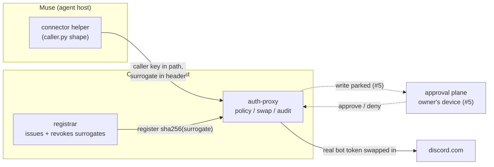

# Proposal + mock: Muse as a caller, Discord as the upstream

**Scope: this is a proposal plus a mock, not a runnable end-to-end
Muse -> Discord client today.** It sketches the caller side of issue #6:
a Muse custom-connector helper that would reach Discord only through
auth-proxy, so every outbound call is policy-checked, audit-logged and, once `require_approval` from issue #5 exists, held for
the owner's approval before it executes.

It cannot reach Discord end-to-end as submitted, for reasons outside this
directory: `runtime_pubkey` is unset in `identity.toml` (the session plane
refuses hello until it is set), the forwarder always sends `Bearer` while
Discord bot tokens need `Bot` (see "Known gap" below), and the example
listener is loopback-only while the remote Muse transport is still open
in #6 (see "Sessions for a Muse caller"). Nothing here touches the proxy core.

Requires Python 3.11+ (`tomllib`, `X | None` annotations). Stdlib only.

## Pieces



## Files

| File | What it is |
|---|---|
| `identity.toml` | Example proxy config (with placeholder digests only): `muse` identity, `discord` route, credential reference, grants. |
| `caller.py` | Proposal caller (Python 3.11+, stdlib only). Shape for a connector helper once #5/#6 settle. |
| `mock_proxy.py` | **Contract sketch for #5, not the real proxy.** Stand-in implementing the sketched caller-facing contract, including the proposed approval flow. It omits canonicalization, policy evaluation, the registry, audit and forwarding. No real Discord call ever happens. |
| `test_caller.py` | Tests of the caller against the mock only: allow, park → approved, park → denied, park → expired, bad surrogate, bare upstream 202, redirect not followed, expiry without polling, colliding upstream marker, two-session isolation and revoke, revoke racing a park, admin token. Green here does not verify the real proxy. |
| `test_policy.py` | Mechanical check of the shipped `identity.toml` against a Python mirror of ap-core's `valid_path` + `Policy::evaluate`. Pins down why a narrow create-message grant is not expressible in Phase 1. |

## Wire protocol (as implemented by the proxy today)

From `crates/ap-client` and `crates/ap-proxy/src/pipeline.rs`:

- Requests are sent to `{base}/ap/<caller-key>/<route><upstream-path>` in
  origin form. The caller key is `apk_` + 64 lowercase hex; the config stores
  only its sha256.
- The session surrogate is `aps_` + 64 lowercase hex, sent in the route's
  surrogate header (default `authorization`) as `Bearer <surrogate>`. The
  proxy registry holds `sha256(surrogate)` per session.
- The proxy canonicalizes the request, checks caller key → identity, route,
  surrogate registration and the grant (identity × credential × route ×
  method × path; a path ending in `/` is a prefix), strips every client auth
  header, sets exactly one credential header with the real secret, and
  forwards upstream. The caller never sees the real credential.

Approval flow (proposed in #5, sketched here, NOT an agreed contract):
a write whose grant requires approval would be answered `202` with a
`request_id` **and the proxy-owned marker header
`X-Auth-Proxy-Approval: parked`** instead of being forwarded. The marker is
what distinguishes a parked request from a legitimate upstream `202`:
`caller.py` treats a bare `202` without that header as an ordinary upstream
response and returns it as-is. The outcome is session-scoped:
`GET {base}/ap/<caller-key>/_approval/<request-id>`, and reports `parked`,
`executed` (with the upstream response), `denied`, or `expired`. `caller.py`
polls it. The poll segment is `_approval`, deliberately not a route-style
name: `parse_ap_path` treats the segment after the caller key as a route
name, and route names must satisfy `valid_slug` (lowercase, digits, `-`),
so a segment containing `_` can never collide with a configured route.
This shape (marker, result schema, poll authorization, expiry /
revocation) is still open in #5; once #5 settles it, the caller and the mock
must be re-derived from that spec rather than freezing this sketch.

Open contract points for #5, which this example cannot settle:

- **The marker must be reserved and stripped by the proxy.** The forwarder
  copies upstream response headers, so an upstream could answer `202` with
  `X-Auth-Proxy-Approval: parked` and a request id of its choosing and push
  the caller into the poll path. #5 must reserve that header, strip it from
  every upstream response, and set it only on proxy-originated parked
  responses. The caller cannot tell the two apart. The mock does not strip
  it on purpose: `test_caller.py` shows the caller's fallback (the made-up id
  is unknown to the proxy, the poll answers 404, the caller exits 2 and
  executes nothing). That is not a substitute for the proxy-side fix.
- **Poll binding.** The mock binds a parked request to the session
  (surrogate) that created it, answers 404 to any other surrogate exactly as
  for an unknown id, drops a session's parked requests on revoke, and uses
  128-bit random ids. #5 must require the same.
- **Expiry.** The mock applies the deadline under its lock before every
  list, approve, deny and outcome operation, so an expired request cannot be
  approved even if the caller stopped polling.
- **Terminal outcomes.** The mock answers a denied or expired poll with
  `200 {"status": "denied" | "expired"}` and the caller maps that to exit 3
  or 4. #5 describes a terminal error for the caller instead. Which of the
  two is the contract (a `200` with a status field, or a non-2xx) is open.

## Generating keys

```sh
python3 - <<'EOF'
import hashlib, secrets
key = "apk_" + secrets.token_hex(32)
print("caller key (give to the caller):", key)
print("caller_key_sha256 (config):     ", hashlib.sha256(key.encode()).hexdigest())
print("surrogate (per session):        ", "aps_" + secrets.token_hex(32))
EOF
```

## Policy walkthrough (`identity.toml`)

- **Reads are granted**: `GET` on `/api/v10/channels/` (prefix). This covers reading message history for mention triage.
- **The read grant is broader than message history, and cannot be narrowed
  in Phase 1.** `valid_path` requires a trailing `/`, so the exact
  `.../messages` path cannot be granted, and the `.../messages/` prefix does
  not match it (see below). The grant therefore also authorizes
  `GET /api/v10/channels/<id>/webhooks`.
  If the bot holds Manage Webhooks, Discord returns webhook tokens there.
  A token lets anyone post to the channel directly through Discord, outside
  policy, audit, revocation and approval. Grant the bot no Manage Webhooks,
  even if you never enable writes. `test_policy.py` pins this behaviour.
  Guild paths and `GET /api/v10/users/@me/guilds` are not granted.
- **Writes are present but commented out.** Phase 1 policy only allows or
  denies, so an enabled write grant would execute immediately, with no
  approval. Uncomment the write grants only together with the
  `require_approval` action from #5, or do it knowingly, accepting immediate
  execution.
- **A narrow create-message grant is not expressible in Phase 1.**
  `valid_path` rejects any non-root grant path that does not end in `/`,
  so the exact create-message path cannot be granted; and because
  `Policy::evaluate` is a raw `starts_with`, the prefix
  `/api/v10/channels/<id>/messages/` can never match the create-message
  path `/api/v10/channels/<id>/messages` (no trailing slash); it would
  silently authorize only sub-paths such as thread creation and
  crossposting. The only Phase 1 grant that authorizes `caller.py send`
  is the whole-channel prefix `/api/v10/channels/<id>/`, whose blast
  radius is every operation under that channel for the granted methods.

  Several endpoints under that prefix are larger than posting:

  - `POST /api/v10/channels/<id>/messages/bulk-delete` deletes 2 to 100
    messages in one call (requires Manage Messages).
  - `POST /api/v10/channels/<id>/webhooks` creates a webhook and returns its
    token (requires Manage Webhooks). Anyone holding the token can post
    directly through Discord, so policy, audit, surrogate revocation and the
    future #5 approval step no longer apply.
  - `POST /api/v10/channels/<id>/invites` creates invite links to the server
    (requires Create Instant Invite).
  - `DELETE`/`PATCH` on the channel itself are not covered: the path
    `/api/v10/channels/<id>` has no trailing slash, so it does not start with
    the prefix.

  The proxy also cannot see message authorship: `DELETE` under that prefix
  removes any user's message if the bot holds Manage Messages. Until matching
  is tightened (exact-path or segment-boundary matching in ap-core, a
  separate core follow-up), the real limit is the bot's Discord-side
  permissions: grant it no Manage Messages, no Manage Webhooks, and no
  Create Instant Invite. `test_policy.py` pins all of this down mechanically.
  Replies use the same create endpoint with a `message_reference` in the JSON
  body. Policy cannot see the body, so the approval step is what would review
  it.

## Known gap: credential scheme (`Bot` vs `Bearer`)

The forwarder always sets the credential header as `Bearer <secret>`
(`crates/ap-proxy/src/forward.rs`, `credential_value`). Discord bot tokens
must be sent as `Bot <token>`, so a live Discord upstream cannot authenticate
against Phase 1 as shipped, for reads and writes alike. Storing `Bot <token>`
as the secret does not help; the prefix is prepended unconditionally.

Minimal change that would unblock the read path (not in this PR, it touches
the proxy core): a per-route credential scheme, e.g.
`credential_scheme = "Bot"`, defaulting to `"Bearer"`, validated against a
small allowlist. Even with that change, this example would still need a set
`runtime_pubkey`, a reachable (non-loopback-only) caller transport from #6,
and, for writes, the settled #5 contract before it could run end-to-end.

## Sessions for a Muse caller

Issue #6 asks how sessions are issued when the caller is Muse. This example
assumes the registrar split from the session plane design:

- The registrar is a small component on the owner's device or home host. It
  holds the identity's private Ed25519 seed. Only the matching public key
  goes into `runtime_pubkey` in `identity.toml`; never put the seed in the
  config. The registrar generates the surrogate per session and registers
  its sha256 with the proxy. The agent receives only the surrogate.
- Revoke is the same lever as for other callers: unregister the surrogate
  (Muse disconnect, session end) and it stops working immediately, together
  with any requests it has parked (#5). The mock models this.
- **The remote transport and a remote registrar are open core and deployment
  work for #6, not something this example provides.** The proxy refuses a
  non-loopback `listen.proxy`, and the session plane is a Unix socket with
  periodic authority renewal, so a phone or laptop registrar cannot reach it
  unchanged.
- Until #6 settles that, the only assumption this example makes is a
  loopback forwarder: something on the proxy host (for example a tailnet-only
  listener or `tailscale serve`) that relays to `127.0.0.1`. That puts the
  caller plane on the tailnet, so anything on the tailnet that learns the
  caller key and a surrogate can call the proxy. The threat model differs
  from loopback only and needs its own review.

## Try it

```sh
python3 test_caller.py        # mock-only contract: allow / approve / deny / expire / refusal / bare 202 / redirect not followed /
                              # expiry without polling / colliding marker / session isolation + revoke
                              # (generates ephemeral keys and passes them to the mock)
python3 test_policy.py        # identity.toml vs ap-core matching rules (mirror; no network)
                              # Both test scripts are manual: nothing runs them in CI,
                              # and green here does not verify the real proxy.
python3 mock_proxy.py &       # or run the mock yourself: it prints fresh ephemeral
                              # MOCK_CALLER_KEY / MOCK_SURROGATE / MOCK_ADMIN_TOKEN on startup
AP_BASE=http://127.0.0.1:<port> \
AP_CALLER_KEY=<apk_... printed by the mock, or your own generated key> \
AP_SURROGATE=<aps_... printed by the mock, or your own generated surrogate> \
python3 caller.py get-messages 2222222222222222222 5
```

The mock's `/_mock/approve|deny|revoke|parked` routes sit on the same
loopback listener as the caller routes, so they require the per-run
`X-Mock-Admin` token printed at startup. Without it, any local process could
approve a parked write.

(No reusable key material is committed in this directory. Keys are
generated ephemerally, by `test_caller.py` via `secrets.token_hex(32)`, or
by the mock at startup, and `identity.toml` carries only a placeholder
digest.)

## Security notes

- The caller key travels in the URL path by design of the session plane; it
  is an identifier-grade authenticator that is useless without a registered
  surrogate, and vice versa. Treat proxy access logs as carrying it.
- Neither the caller key nor the surrogate can be exchanged for the real
  credential: the swap happens only inside the proxy, per request, against a
  matching grant.
- Fail closed at every layer you control: an unmatched path, an unregistered
  surrogate, or a missing runtime key is a refusal, never a fallback to a
  direct upstream call. `caller.py` has no direct-to-Discord code path at
  all.
- The surrogate must not leave the proxy boundary in the caller either:
  `caller.py` uses an explicit opener with redirect following disabled
  and ambient `http_proxy`/`https_proxy` ignored (`ProxyHandler({})`), so
  an upstream 3xx is treated as an error (exit 2) instead of resending the
  `Authorization` header to the `Location` host. This mirrors the proxy's
  own `reqwest::redirect::Policy::none()`. `test_caller.py` pins it with a
  mock 302 to an external counting server and asserts no second request.
