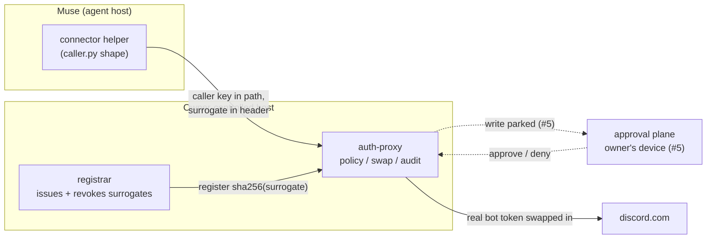

# Proposal + mock: Muse as a caller, Discord as the upstream

**Scope: this is a proposal plus a mock, not a runnable end-to-end
Muse -> Discord client today.** It sketches the caller side of issue #6 —
a Muse custom-connector helper that would reach Discord only through
auth-proxy, so every outbound call is policy-checked, audit-logged, and —
once `require_approval` from issue #5 exists — held for the owner's
approval before it executes.

It cannot reach Discord end-to-end as submitted, for reasons outside this
directory: `runtime_pubkey` is unset in `identity.toml` (the session plane
refuses hello until it is set), the forwarder always sends `Bearer` while
Discord bot tokens need `Bot` (see "Known gap" below), and the example
listener is loopback-only while the remote Muse transport is still open
in #6. Nothing here touches the proxy core.

## Pieces



## Files

| File | What it is |
|---|---|
| `identity.toml` | Example proxy config (with placeholder digests only): `muse` identity, `discord` route, credential reference, grants. |
| `caller.py` | Proposal caller (Python, stdlib only). Shape for a connector helper once #5/#6 settle. |
| `mock_proxy.py` | **Contract sketch for #5, not the real proxy.** Stand-in implementing the sketched caller-facing contract, including the proposed approval flow. It omits canonicalization, policy evaluation, the registry, audit and forwarding. No real Discord call ever happens. |
| `test_caller.py` | Tests of the caller against the mock only: allow, park → approved, park → denied, park → expired, bad surrogate. Green here does not verify the real proxy. |

## Wire protocol (as implemented by the proxy today)

From `crates/ap-client` and `crates/ap-proxy/src/pipeline.rs`:

- Requests are sent to `{base}/ap/<caller-key>/<route><upstream-path>` in
  origin form. The caller key is `apk_` + 64 lowercase hex; the config stores
  only its sha256.
- The session surrogate is `aps_` + 64 lowercase hex, sent in the route's
  surrogate header (default `authorization`) as `Bearer <surrogate>`. The
  proxy registry holds `sha256(surrogate)` per session.
- The proxy canonicalizes the request, checks caller key → identity, route,
  surrogate registration and the grant (identity × credential × route ×
  method × path; a path ending in `/` is a prefix), strips every client auth
  header, sets exactly one credential header with the real secret, and
  forwards upstream. The caller never sees the real credential.

Approval flow (proposed in #5, sketched here — NOT an agreed contract):
a write whose grant requires approval would be answered `202` with a
`request_id` **and the proxy-owned marker header
`X-Auth-Proxy-Approval: parked`** instead of being forwarded. The marker is
what distinguishes a parked request from a legitimate upstream `202`:
`caller.py` treats a bare `202` without that header as an ordinary upstream
response and returns it as-is. The outcome is caller-scoped —
`GET {base}/ap/<caller-key>/requests/<request-id>` — and reports `parked`,
`executed` (with the upstream response), `denied`, or `expired`. `caller.py`
polls it. This shape (marker, result schema, poll authorization, expiry /
revocation) is still open in #5; once #5 settles it, the caller and the mock
must be re-derived from that spec rather than freezing this sketch.

## Generating keys

```sh
python3 - <<'EOF'
import hashlib, secrets
key = "apk_" + secrets.token_hex(32)
print("caller key (give to the caller):", key)
print("caller_key_sha256 (config):     ", hashlib.sha256(key.encode()).hexdigest())
print("surrogate (per session):        ", "aps_" + secrets.token_hex(32))
EOF
```

## Policy walkthrough (`identity.toml`)

- **Reads are granted**: `GET` on `/api/v10/channels/` and `/api/v10/guilds/`
  (prefixes). This covers reading message history for mention triage.
- **Writes are present but commented out.** Phase 1 policy only allows or
  denies, so an enabled write grant would execute immediately, with no
  approval. Uncomment the write grants only together with the
  `require_approval` action from #5 — or knowingly, accepting immediate
  execution.
- Write grants are per channel in prefix form: config validation rejects
  non-root grant paths that do not end in `/`, so the grant is
  `/api/v10/channels/<id>/messages/` — not the exact create-message path.
  That prefix also matches sub-paths such as message edits under the same
  channel, so scope it knowingly. Replies use the same endpoint with a
  `message_reference` in the JSON body. Policy cannot see the body; the
  approval step is what reviews it. That split is intentional.

## Known gap: credential scheme (`Bot` vs `Bearer`)

The forwarder always sets the credential header as `Bearer <secret>`
(`crates/ap-proxy/src/forward.rs`, `credential_value`). Discord bot tokens
must be sent as `Bot <token>`, so a live Discord upstream cannot authenticate
against Phase 1 as shipped — for reads and writes alike. Storing `Bot <token>`
as the secret does not help; the prefix is prepended unconditionally.

Minimal change that would unblock the read path (not in this PR, it touches
the proxy core): a per-route credential scheme, e.g.
`credential_scheme = "Bot"`, defaulting to `"Bearer"`, validated against a
small allowlist. Even with that change, this example would still need a set
`runtime_pubkey`, a reachable (non-loopback-only) caller transport from #6,
and — for writes — the settled #5 contract before it could run end-to-end.

## Sessions for a Muse caller

Issue #6 asks how sessions are issued when the caller is Muse. This example
assumes the registrar split from the session plane design:

- The registrar is a small component on the owner's device or home host. It
  holds the identity's runtime Ed25519 key (`runtime_pubkey` in
  `identity.toml`), generates the surrogate per session, and registers its
  sha256 with the proxy. The agent receives only the surrogate.
- Revoke is the same lever as for other callers: unregister the surrogate
  (Muse disconnect, session end) and it stops working immediately, together
  with any requests it has parked (#5).
- The remote-caller transport (Muse's host is not the proxy's host) is the
  open part of #6: the caller plane must be reachable by the agent without
  being reachable by the world — in the owner's deployment that is a
  tailnet-only listener. The proxy itself does not change for this; the
  caller key plus registered surrogate remain the authentication.

## Try it

```sh
python3 test_caller.py        # mock-only contract: allow / approve / deny / expire / refusal
                              # (generates ephemeral keys and passes them to the mock)
python3 mock_proxy.py &       # or run the mock yourself: it prints fresh ephemeral
                              # MOCK_CALLER_KEY / MOCK_SURROGATE values on startup
AP_BASE=http://127.0.0.1:<port> \
AP_CALLER_KEY=<apk_... printed by the mock, or your own generated key> \
AP_SURROGATE=<aps_... printed by the mock, or your own generated surrogate> \
python3 caller.py get-messages 2222222222222222222 5
```

(No reusable key material is committed in this directory. Keys are
generated ephemerally — by `test_caller.py` via `secrets.token_hex(32)`, or
by the mock at startup — and `identity.toml` carries only a placeholder
digest.)

## Security notes

- The caller key travels in the URL path by design of the session plane; it
  is an identifier-grade authenticator that is useless without a registered
  surrogate, and vice versa. Treat proxy access logs as carrying it.
- Neither the caller key nor the surrogate can be exchanged for the real
  credential: the swap happens only inside the proxy, per request, against a
  matching grant.
- Fail closed at every layer you control: an unmatched path, an unregistered
  surrogate, or a missing runtime key is a refusal, never a fallback to a
  direct upstream call. `caller.py` has no direct-to-Discord code path at
  all.
