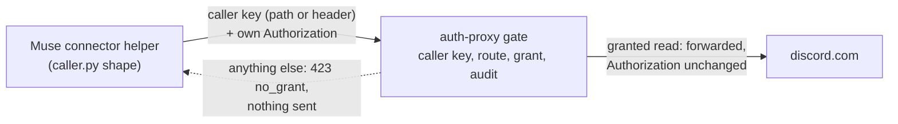

# Reference caller + mock: Muse as a caller, Discord as the upstream

**Scope: a reference caller and a mock of the gate, not a runnable end-to-end
Muse -> Discord client.** It shows the caller side of the Muse gated
passthrough as merged to `main` (stage 1). The real gate is
`crates/ap-proxy/src/passthrough.rs`; the contract is in
[`docs/design/muse-gated-passthrough.md`](../../docs/design/muse-gated-passthrough.md),
the measurements in [`docs/evidence/muse-stage1.md`](../../docs/evidence/muse-stage1.md),
the operator steps in [`docs/runbooks/muse-stage1.md`](../../docs/runbooks/muse-stage1.md)
and the policy in
[`deploy/muse/pilot-policy.example.toml`](../../deploy/muse/pilot-policy.example.toml).
Nothing here touches code outside `examples/`.

Requires Python 3.11+ (`tomllib`, `X | None` annotations). Stdlib only.

## What stage 1 does

The gate holds no Discord credential and swaps nothing. Muse's egress puts the
real Discord credential in `Authorization`, the gate passes that header
through unchanged and only decides allow or deny.



- **Caller key, one place only.** Either the path prefix
  `/ap/<caller-key>/<route>/...` (the form the Muse connector used in the
  stage 1 measurements) or the `X-AP-Caller-Key` header (name configurable
  with `passthrough.caller_key_header`). Both at once is 400
  `caller_key_ambiguous`. `Authorization` is never a key source. The prefix is
  stripped before routing and forwarding, and the caller-key header and every
  `x-ap-*` header are removed before the request goes upstream.
- **Route.** The first path segment names a route that policy maps to a fixed
  host. An unknown name is 423 `route_unknown`; nothing in the request can pick
  the upstream host.
- **Policy.** Pilot policy: `GET` on `/api/v10/channels/`, `/api/v10/guilds/`
  and `/api/v10/users/@me` (raw `starts_with` on the route-relative path).
  Everything else is refused 423 `no_grant`.
- **Writes in stage 1: 423 `no_grant`.** `POST /api/v10/channels/<id>/messages`
  has no grant, so `caller.py send` is expected to exit 3 against the real
  gate. No hold or approval flow exists on `main`.
- **Refusal body.** Every refusal the gate generates carries `X-AP-Decision`
  and the body `{"ap_decision": "<decision>", "code": "<code>"}`. The real Muse
  helper drops response headers and shows the agent only `HTTP <status>: <body>`,
  so `caller.py` reads the decision from the body alone. A Discord error object
  has `message` and `code` and no `ap_decision`, so it is not taken for a gate
  refusal (it is an upstream error, exit 2). Stage 1 refusals:

  | Case | Status | Decision | `code` |
  |---|---|---|---|
  | no grant (writes included) | 423 | `denied` | `no_grant` |
  | unknown route | 423 | `denied` | `route_unknown` |
  | missing, duplicate, malformed or unknown key, or `/ap/<key>` with no `/` after the key | 401 | `rejected` | `caller_rejected` |
  | valid key with no route (`/ap/<key>/`) | 423 | `denied` | `route_unknown` |
  | key in both header and path | 400 | `denied` | `caller_key_ambiguous` |
  | more than one `Authorization` | 400 | `denied` | `authorization_duplicate` |
  | `CONNECT` | 405 | `denied` | `connect_refused` |
  | WebSocket upgrade | 501 | `denied` | `websocket_unsupported` |
  | body over the limit | 413 | `denied` | `body_too_large` |
  | other canonicalization or framing refusal | 400 | `denied` | Phase 1 code |
  | gate cannot decide, request body read timed out, or upstream connect failed | 503 | `unavailable` | e.g. `policy_unavailable`, `body_read_timeout`, `connect_failed` |

  The complete list is `ap_core::outcome::passthrough_outcome`. `caller.py`
  maps every `denied`/`rejected` to exit 3 and every `unavailable` to exit 5.

  A failure after the request was sent upstream is not a refusal: the gate
  closes the connection and sends no answer. `caller.py` reports that as a
  transport error (exit 2) and says the write may have reached Discord.

## Stage 2: in review, not on main

The design also has held writes (`decision = "hold"`, a human approves, then
the held request is forwarded; 410 `expired` if nobody decides). None of that
is merged. `caller.py` already maps an `expired` decision to exit 4 so the
helper does not need to change shape, but main sends `expired` only from its
stage 1 measurement probe (which this caller cannot reach), never from a
production path, and the mock does not model hold or approval. Do not rely on either until stage 2 lands.

## Credential scheme (issue #12)

In passthrough mode the gate never sets `Bearer` or `Bot`: the scheme is
whatever Muse injects, so Muse must send `Authorization: Bot <token>` for a
Discord bot token. The forwarder's hard-coded `Bearer` prefix only affects the
credential-swap path of the sidecar mode; the per-route `credential_scheme` fix
is tracked in [#12](https://github.com/openabdev/auth-proxy/issues/12) and
does not change this example.

## Files

| File | What it is |
|---|---|
| `caller.py` | Reference caller (Python 3.11+, stdlib only): path or header key, own `Authorization`, decision read from the body, no redirects, no ambient proxy, validated `AP_BASE`, bounded responses, fixed key-free error messages. |
| `mock_proxy.py` | **Mock of the stage 1 gate, not the real proxy.** Models key placement, route, duplicate `Authorization`, grant (read from the pilot policy) and the refusal shape, with a fabricated upstream. It omits canonicalization, the `Host` check, framing checks, body limits, audit, TLS and real forwarding, and has no hold or approval flow. |
| `test_caller.py` | Tests of the caller against the mock only. |
| `test_policy.py` | Checks the pilot policy against a Python mirror of ap-core's `valid_prefix_path` and `Policy::evaluate`, and pins what it does and does not authorize. |

There is no config file in this directory: the policy is the pilot example under `deploy/muse/`.

## Exit codes

| Code | Meaning |
|---|---|
| 0 | success (2xx) |
| 2 | transport error (cannot connect, TLS, timeout, connection closed without a complete answer, malformed HTTP), upstream error, malformed gate answer, or response over the cap |
| 3 | refused by the gate (`denied` or `rejected`) |
| 4 | decision `expired` (stage 2, in review) |
| 5 | gate `unavailable` (503, retry later) |
| 64 | usage or configuration error, including a malformed `AP_BASE` |
| 70 | unexpected internal error (fixed message, no traceback) |

`AP_BASE` must be `http://` or `https://` plus a host and an optional port:
no path, query, fragment, userinfo, whitespace or control characters. It is
validated before any URL holding the caller key is built. Response bodies are
capped at 8 MiB (a larger declared `Content-Length` is rejected before reading;
reads stop at cap + 1 bytes) and one exchange has a 60 s wall-clock budget.
Every error message is fixed text: none contains a URL, the `/ap/<key>` prefix
or the key, and none is followed by a traceback.

## Generating a key

```sh
python3 - <<'PY'
import hashlib, secrets
key = "apk_" + secrets.token_hex(32)
print("caller key (give to the connector):", key)
print("caller_key_sha256 (policy file):   ", hashlib.sha256(key.encode()).hexdigest())
PY
```

## Read-side risk of the prefixes

The grants are raw prefixes, so `GET /api/v10/channels/` also authorizes
`GET /api/v10/channels/<id>/webhooks`. If the bot holds Manage Webhooks,
Discord returns webhook tokens there, and a token lets anyone post to the
channel directly, outside the gate. Grant the bot no Manage Webhooks.
`test_policy.py` pins this. The gate constrains the agent, not the Muse
platform: Muse's egress holds the real token and can call Discord directly.

## Try it

```sh
python3 test_caller.py        # caller vs the mock: path and header key, Authorization unchanged,
                              # 423 no_grant for writes, 401, route_unknown, ambiguous key,
                              # duplicate Authorization, upstream 401 is not a gate refusal,
                              # redirect not followed, malformed AP_BASE, aborted connections,
                              # oversized bodies, and no key in any output on any exit path
python3 test_policy.py        # pilot policy vs ap-core matching rules (mirror; no network)
                              # Both are manual: nothing runs them in CI, and green here
                              # does not verify the real gate.
python3 mock_proxy.py &       # or run the mock yourself; it prints MOCK_PORT and a fresh MOCK_CALLER_KEY
export AP_BASE=http://127.0.0.1:<port>
export AP_CALLER_KEY=<apk_... printed by the mock>
export AP_AUTHORIZATION="Bot placeholder"
python3 caller.py get-messages 2222222222222222222 5
python3 caller.py send 2222222222222222222 hi        # exit 3: 423 denied/no_grant
```

For the real gate, follow the runbook, point `AP_BASE` at the front, and leave
`AP_AUTHORIZATION` unset when the Muse platform injects the credential. No
reusable key material is committed here.

## Security notes

- The path form puts the caller key in the URL. Anything in front of the gate
  that logs URLs sees it; treat such logs as secret. The header form keeps it
  out of the URL. Neither the audit line nor error bodies contain it.
- The caller key authenticates the connector to the gate. It is not a Discord
  credential and not an approval credential.
- Fail closed: a refusal is never retried as a direct Discord call. `caller.py`
  has no direct-to-Discord code path.
- The `Authorization` header must not leave the gate boundary through the
  caller: `caller.py` uses an explicit opener with redirect following disabled
  and ambient `http_proxy`/`https_proxy` ignored, so an upstream 3xx is an
  error (exit 2) instead of resending the header to the `Location` host.
  `test_caller.py` pins this with a 302 to a counting external server.
- The key never reaches stdout or stderr. `test_caller.py` runs every failure
  mode (malformed bases, refusals, aborted connections, oversized bodies,
  forced exceptions) with a sentinel key and asserts neither the key nor
  `/ap/` appears in either stream.
